# Whisky Collection Manager

<p align="center">
  
</p>

<p align="center"><strong>Your whisky. Your records. Your data.</strong></p>

<p align="center">
  <a href="README.md">Deutsch</a> · <a href="README.en.md">English</a>
</p>

<p align="center">
  <a href="https://github.com/henryk86/whisky-collection-manager/releases/latest"></a>
  <a href="LICENSE"></a>
</p>

Whisky Collection Manager (WCM) is a self-hosted web application for managing a whisky collection locally. It combines **inventory management, insurance documentation, tasting notes, tasting flights, storage planning and encrypted backups** in a single application – without a database and without a frontend build step.

All data is stored locally in versioned JSON files. WCM is especially useful for collectors who want to **document their collection in a traceable way** and keep photos, purchase records and inventory reports ready for their own insurance documentation.

## Why WCM?

- **Insurance documentation instead of just an inventory list:** inventory numbers, bottle photos, purchase data, purchase evidence markers and PDF/ZIP exports for your own records.
- **Physical storage management:** rooms, furniture, shelves, 2D/3D views and bottle lookup by storage location.
- **Tasting and planning:** free and bottle-linked tastings, flavour profiles, notes and intelligent tasting-flight planning.
- **Self-hosted and privacy-friendly:** no cloud requirement, no database, encrypted backups and offline releases.

## Feature overview

| Area | Highlights |
| --- | --- |
| Collection and bottles | Bottlings, standard and sample bottles, inventory numbers, purchase and storage data, search, filters and scanner |
| Tastings | Independent or bottling-linked; ratings with comments, flavour profile plus nose/palate/finish notes |
| Tasting flights | Multiple planning strategies, shared flight notes, availability filters and optimised tasting order |
| Photos and evidence | Bottle photo editing and ordering, optional local AI cutouts; documents per physical bottle with preview and download |
| Storage | Rooms, furniture and shelves, bottle moves, bottle finder and 2D/3D room plans |
| Insurance documentation | Evidence completeness per physical bottle, purchase evidence markers, PDF reports and ZIP package with originals |
| Analytics and map | Collection and value analytics plus an OpenStreetMap distillery map |
| Backup | Encrypted backups with scheduled profiles, different targets and restore support |
| UI and access | Responsive, German/English, light/dark mode and optional authentication with user management |

## Screenshots

The screenshots show example data only and use the English interface. The storage views illustrate demo layouts with a capacity of **50 bottle slots**. The 3D model and map are cropped from existing demo captures to show the visualisations without language-specific controls.

| Collection – light | Collection – dark |
| --- | --- |
| 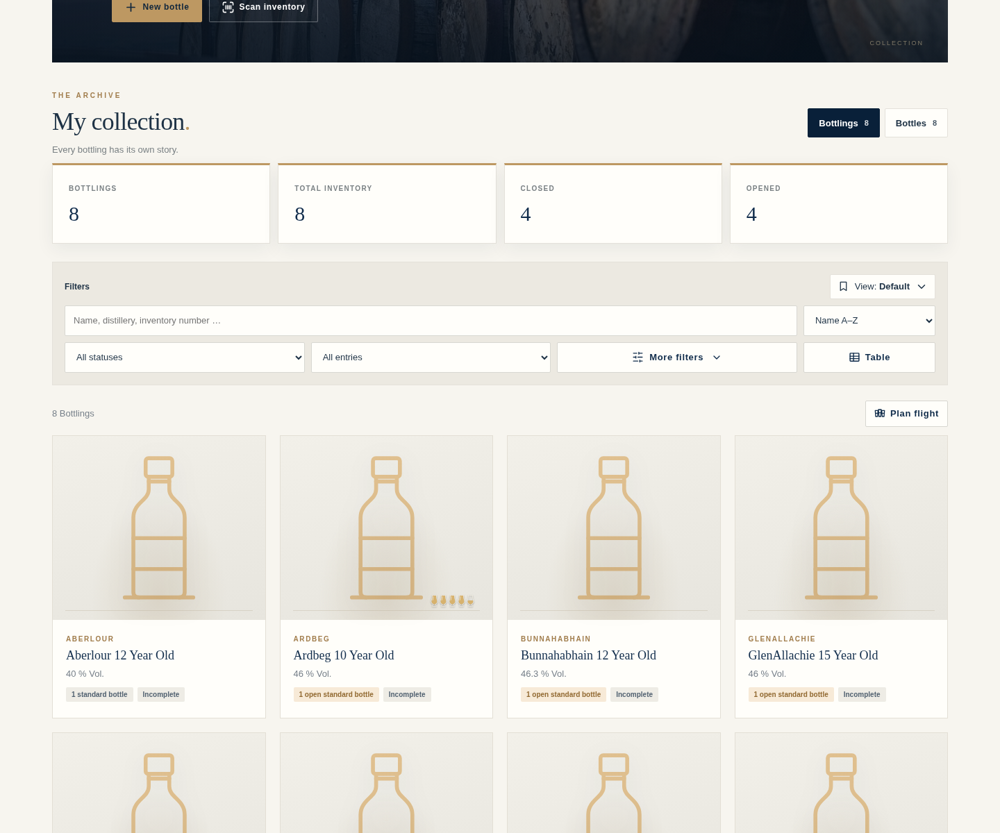 | 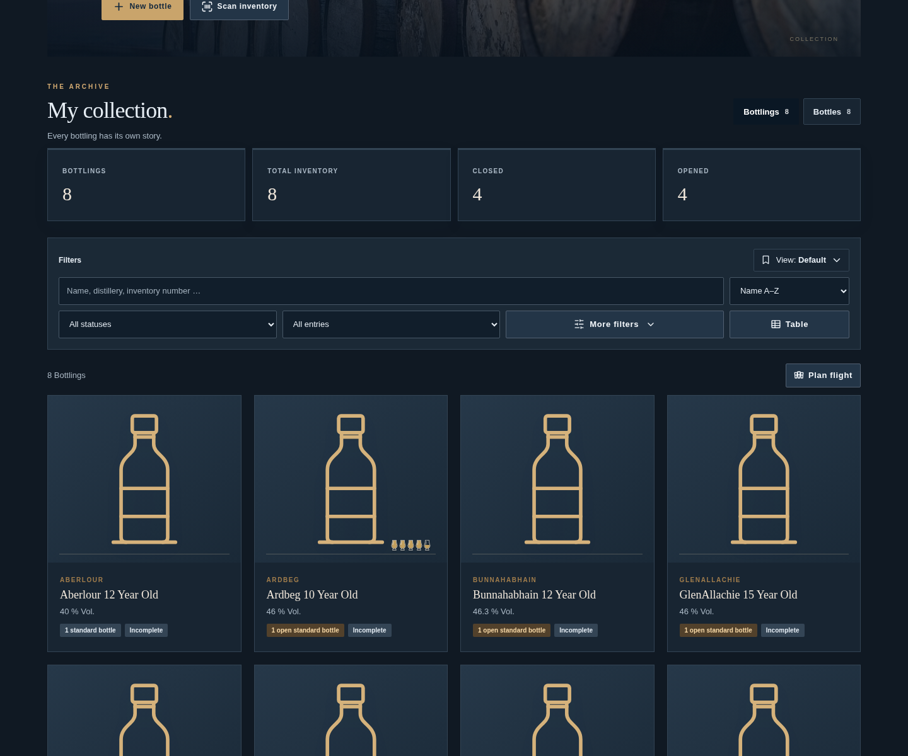 |

<details>
<summary>Mobile collection view</summary>

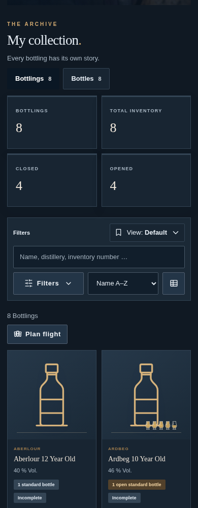

</details>

**Whisky room – 3D view**

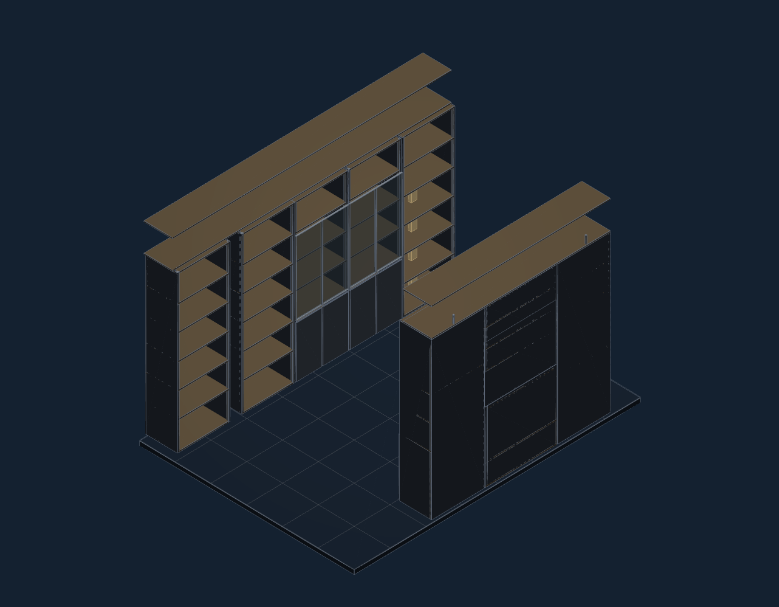

<details>
<summary>Show the 2D room plan and shelf view</summary>

| Room plan (2D) | Shelves |
| --- | --- |
| 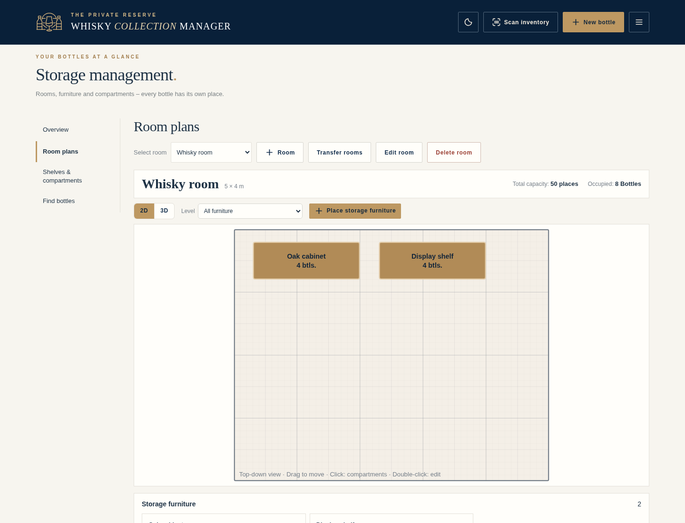 | 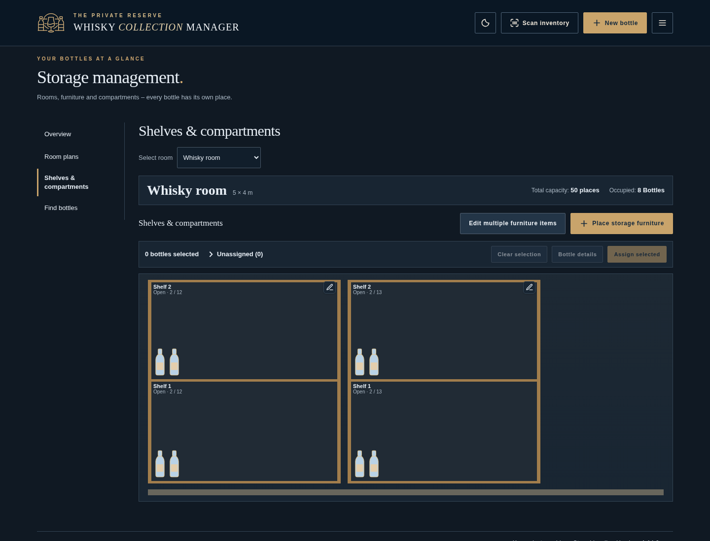 |

</details>

**More views**

| Bottle finder | Analytics |
| --- | --- |
| 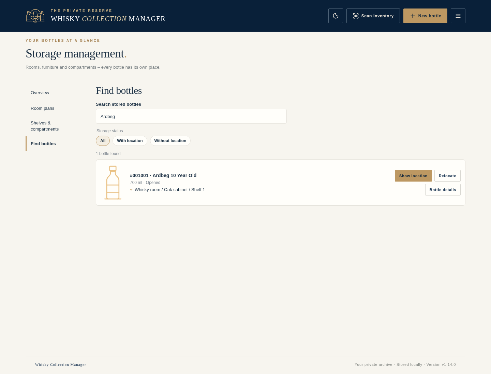 | 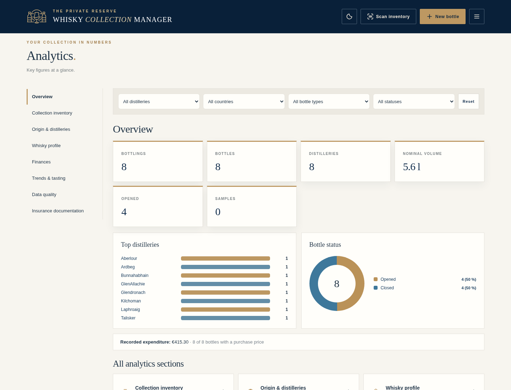 |

**Insurance documentation**

| Evidence review | Insurance report |
| --- | --- |
| 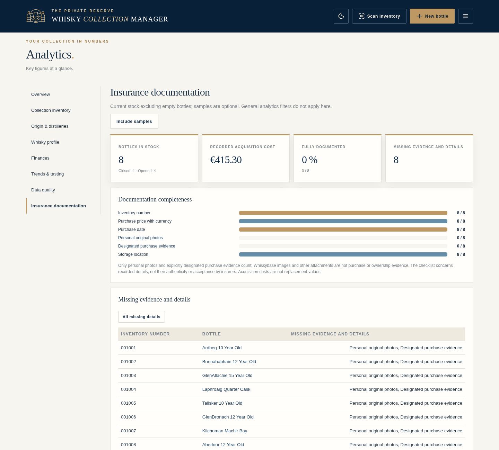 | 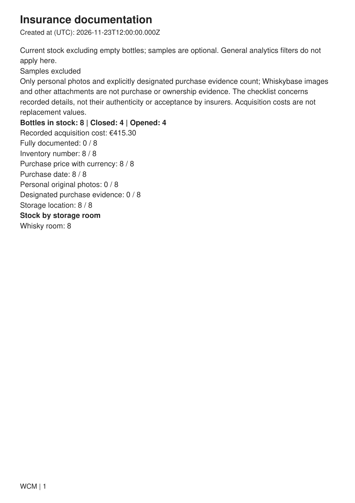 |

**Tasting and flight planning**

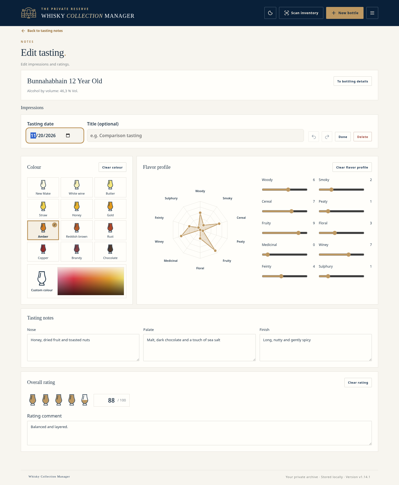

<details>
<summary>Show tasting-flight planning</summary>

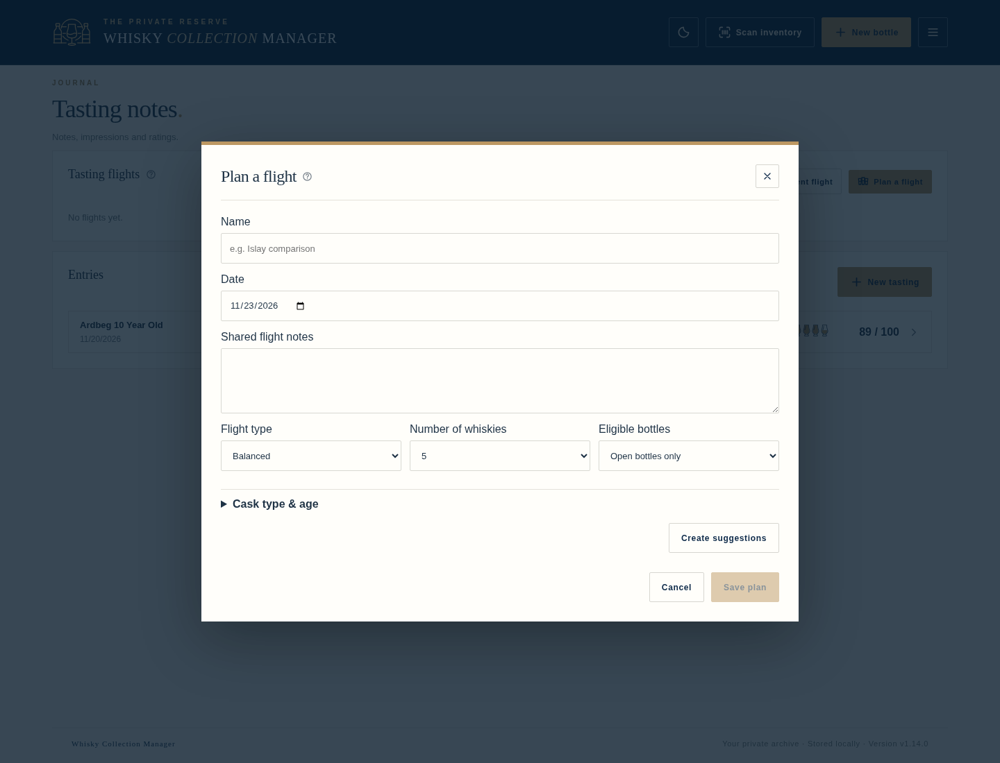

</details>

**Distillery map**

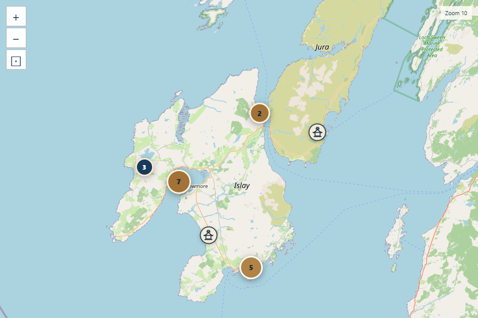

Map data © [OpenStreetMap contributors](https://www.openstreetmap.org/copyright).

## Installation and operation

### Quick start options

| Scenario | Best for | Entry point |
| --- | --- | --- |
| **Local on Windows/macOS/Linux** | Running on your own machine | `npm start` |
| **Docker** | Always-on server or NAS | `docker compose up -d` |
| **Raspberry Pi** | Low-power home server | `sh deploy/setup-pi.sh` |
| **Offline release** | Installation without ongoing package downloads | [Offline releases](docs/OFFLINE_RELEASES.md) |

### Run locally

**Requirements:** Node.js 20 or newer; OpenSSL or `mkcert` for the initial HTTPS certificate generation.

```bash
npm start
```

The launcher installs npm dependencies when needed, prepares local AI files and creates a missing `.env` file plus default HTTPS certificates. The first start may therefore require internet access. By default the application is reachable at **`https://localhost:3543`**.

Details: [Local development and HTTPS](docs/ENTWICKLUNG.md) · [Offline installation](docs/OFFLINE_RELEASES.md).

### Docker and Raspberry Pi

**Requirements:** Docker Engine with the Compose plugin, Git and OpenSSL. Raspberry Pi OS (64 bit) is recommended for Raspberry Pi deployments.

```bash
git clone --branch main https://github.com/henryk86/whisky-collection-manager.git
cd whisky-collection-manager
cp deploy/.env.example .env
# Configure your own CERT_IP_ADDRESSES / CERT_DNS_NAMES in .env.
sh deploy/setup-pi.sh
docker compose pull
docker compose up -d --remove-orphans
```

Afterwards the application is reachable at **`https://<IP-or-host>:3543`** as long as the address is part of the certificate. The external HTTPS port can be changed via `HTTPS_PUBLIC_PORT`. Publicly trusted certificates via Certbot with DNS-01 are also supported: [Set up Let's Encrypt](docs/LETS_ENCRYPT.md).

More guides: [Docker, updates and backups](docs/DOCKER_BACKUP.md) · [Offline releases](docs/OFFLINE_RELEASES.md).

### Authentication and security

**Login is disabled by default.** An administrator can enable mandatory login under **Settings → User management**. WCM is intended for operation inside a trusted private network or behind a VPN. Direct public exposure to the internet is not recommended, even with HTTPS and login enabled.

On first start the `admin` user is created with an **individual initial password**, printed once in the server logs (`docker compose logs app`). The first login requires a password change. Accounts are stored in `data/user.json`; passwords are stored as salted scrypt hashes only.

More information: [Authentication and user management](docs/ANMELDUNG.md) · [Security policy](SECURITY.md).

## Development and releases

Changes are collected on `develop`. The version number is set automatically only during the manually approved release merge to `main`; `main` is the protected default branch. Conventional commit messages are intended for local commits.

```bash
npm run hooks:install  # Validate commit messages locally (once per clone)
npm run check          # Syntax, modules, translations and documentation links
npm test               # Unit and integration tests without the browser
npx playwright-core install --with-deps chromium
npm run test:browser   # Browser tests with Playwright/Chromium
```

CI runs the relevant checks. Only documentation that is actually affected by a PR needs to be updated; individual commits do not require their own documentation or justification. The PR description may stay empty and is not enforced by CI.

The release process and version synchronisation are documented in the [release workflow](docs/RELEASE_WORKFLOW.md); test results are summarised in [test status](docs/TESTSTATUS.md), changes in the [changelog](CHANGELOG.md).

## More documentation

- **Features:** [Requirements](docs/ANFORDERUNGEN.md), [Storage](docs/LAGER.md), [Flavour profile](docs/GESCHMACKSPROFIL.md), [Photo editor](docs/PHOTO_FREISTELLUNG.md), [Analytics](docs/ANALYSE.md), [Map](docs/KARTE.md).
- **Technical:** [Architecture](docs/ARCHITEKTUR.md), [API](docs/API.md), [Development](docs/ENTWICKLUNG.md), [Test strategy](docs/TESTSTRATEGIE.md), [technical debt](docs/TECHNISCHE_SCHULDEN.md).
- **Repository presentation:** [GitHub repository profile](docs/GITHUB_REPOSITORY_PROFILE.md).

License: [MIT](LICENSE). Additional licence terms may apply to bundled third-party libraries or media.
