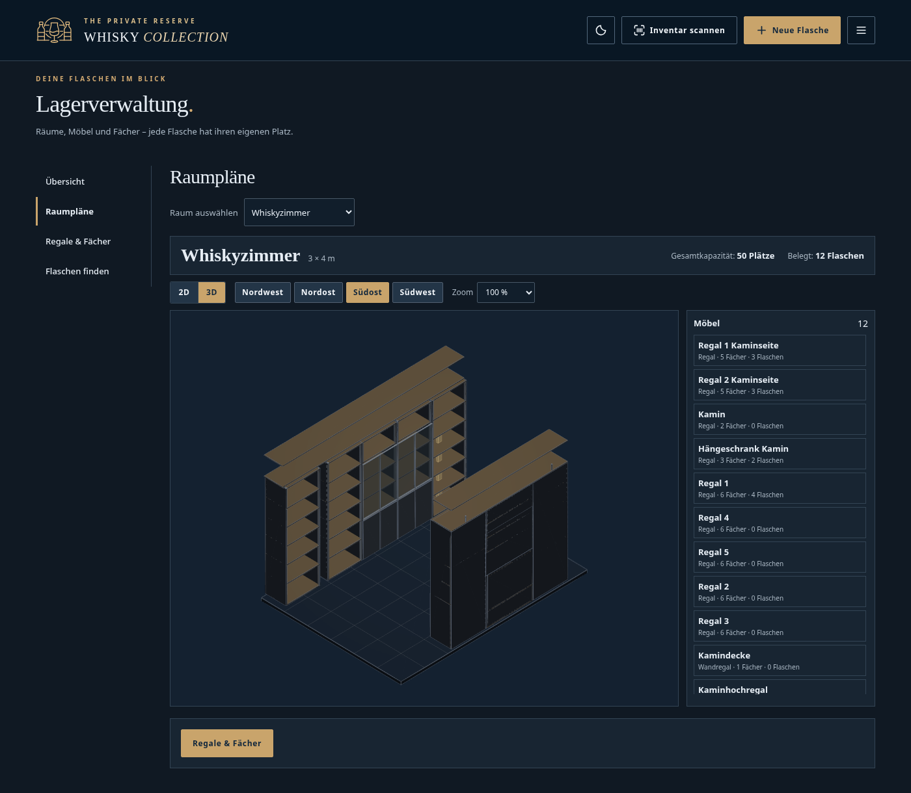
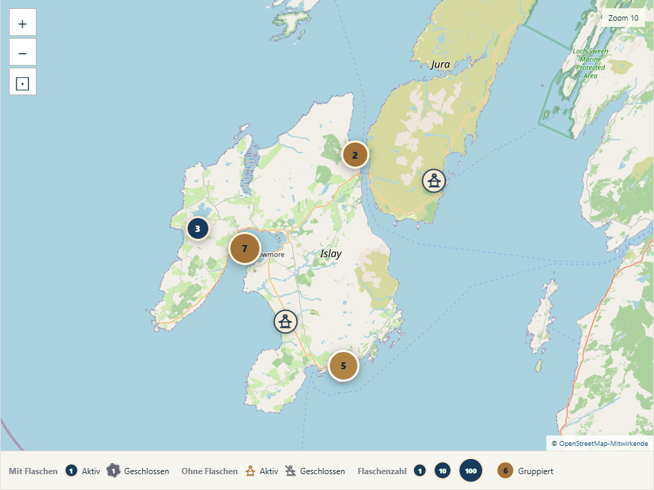

# Whisky Collection Manager v1.6.2

Webanwendung zur lokalen Verwaltung einer Whisky-Sammlung mit einzelnen Flaschen, Verkostungen und Lagerplätzen. Die Anwendung basiert auf Node.js und Browser-ES-Modulen, benötigt keine Datenbank und keinen Frontend-Build. Sammlung und Lager werden in JSON-Dateien gespeichert.


## Funktionen

- **Sammlung:** Abfüllungen und physische Flaschen, Inventarnummern, Kaufdaten, Zustände, Suche, Filter, Scanner sowie Fotos und Belege.
- **Verkostungen:** Datierte Verkostungen zu Abfüllungen, unabhängige Verkostungen, Tasting-Flights, Geschmacksprofile und Bewertungen.
- **Fotos:** Bildbearbeitung und optionale lokale KI-Freistellung von Flaschenfotos.
- **Lager:** Räume, Möbel, Fächer, Flaschenzuordnung und Umlagerung; Raumpläne in 2D und 3D.
- **Auswertungen und Karte:** Sammlungs- und Wertanalysen sowie eine Destilleriekarte auf Basis von OpenStreetMap.
- **Datensicherung:** Verschlüsselte Backups mit konfigurierbaren Speicherzielen und Wiederherstellung.
- **Bedienung:** Responsive Oberfläche auf Deutsch und Englisch, mit Hell-/Dunkelmodus und integrierter Hilfe.

## Oberfläche

Die Abbildungen zeigen Beispieldaten ohne private Sammlungsdaten. Für die Lageransichten wurde das Raumlayout eines Whiskyzimmers mit einer auf insgesamt **50 Flaschenplätze** reduzierten Demo-Kapazität verwendet.

| Sammlung – hell | Sammlung – dunkel |
| --- | --- |
|  |  |

<details>
<summary>Mobile Sammlungsansicht</summary>


</details>

**Whiskyzimmer – 3D-Raumansicht**



<details>
<summary>2D-Raumplan und Regalansicht anzeigen</summary>

| Raumplan (2D) | Regale und Fächer |
| --- | --- |
|  |  |

</details>

**Weitere Ansichten**

| Flaschen finden | Analysen |
| --- | --- |
|  |  |

**Destillerie-Karte**



## Lokal starten

**Voraussetzung:** Node.js 20 oder neuer; für die erstmalige HTTPS-Zertifikatserstellung OpenSSL oder `mkcert`.

```bash
npm start
```

Der Starthelfer installiert bei Bedarf npm-Abhängigkeiten, bereitet die lokalen KI-Dateien vor und erstellt eine fehlende `.env` sowie Standard-HTTPS-Zertifikate. Beim ersten Start kann dafür Internetzugang erforderlich sein. Die Anwendung ist standardmäßig über **`https://localhost:3543`** erreichbar. Für den Zugriff über eine andere IP oder einen Hostnamen muss das Zertifikat entsprechend eingerichtet werden.

Details: [Lokale Entwicklung und HTTPS](docs/ENTWICKLUNG.md) · [Offline-Installation](docs/OFFLINE_RELEASES.md).

## Raspberry Pi und Docker

**Voraussetzungen:** Raspberry Pi OS (64 Bit), Docker Engine mit Compose-Plugin, Git und OpenSSL.

```bash
git clone --branch main https://github.com/henryk86/whisky-collection-manager.git
cd whisky-collection-manager
cp deploy/.env.example .env
# In .env die eigenen CERT_IP_ADDRESSES / CERT_DNS_NAMES eintragen.
sh deploy/setup-pi.sh
docker compose pull
docker compose up -d --remove-orphans
```

Anschließend ist die Anwendung unter **`https://<IP-des-Pi>:3543`** erreichbar, sofern diese IP im Zertifikat eingetragen ist. Der externe HTTPS-Port ist über `HTTPS_PUBLIC_PORT` konfigurierbar (auch `443`). Optional kann über **Certbot mit DNS-01** ein öffentlich vertrauenswürdiges Zertifikat auf einem separaten HTTPS-Port bereitgestellt werden (netcup CloudDNS/Legacy, Cloudflare oder RFC 2136); die bisherige Installation bleibt Standard. [Anleitung: Let's Encrypt](docs/LETS_ENCRYPT.md). Die Einrichtungsroutine legt das persistente Datenverzeichnis außerhalb des Repositorys an. Beim Aktualisieren des Containers bleiben diese Daten erhalten; vor Updates sollte trotzdem ein vollständiges Backup erstellt werden.

**Sicherheit:** Die Loginpflicht ist optional und anfangs deaktiviert. Bei öffentlich erreichbaren Installationen unbedingt Loginpflicht und HTTPS aktivieren; zusätzliche Netzabsicherung/VPN bleibt empfohlen.

Einrichtung, Updates, Backup und Wiederherstellung: [Docker und Datensicherung](docs/DOCKER_BACKUP.md). Für die Wiederherstellung ohne externe Paket- oder Containerquellen: [Offline-Releases](docs/OFFLINE_RELEASES.md).

## Optionale Anmeldung

Die **Loginpflicht ist standardmäßig deaktiviert**. Nach Anmeldung als Administrator lässt sie sich unter **Einstellungen → Nutzerverwaltung** aktivieren. Weitere Nutzer erhalten alle Sammlungsfunktionen, aber keinen Zugriff auf die Nutzerverwaltung.

Beim ersten Start wird `admin` mit einem **individuellen Startpasswort** angelegt; es steht einmalig in den Serverlogs (`docker compose logs app`). Bei der ersten Anmeldung ist ein Passwortwechsel Pflicht. Die Konten liegen in `data/user.json`, Passwörter nur als gesalzene scrypt-Hashes. Zugang, Passwortwiederherstellung und Betrieb: [Anmeldung und Nutzerverwaltung](docs/ANMELDUNG.md).

## Entwicklung und Releases

Änderungen werden auf `develop` gesammelt. Die Versionsnummer wird erst beim manuell freigegebenen Release-Merge nach `main` automatisch festgelegt; `main` ist der geschützte Standardbranch. Für lokale Commits sind Conventional-Commit-Nachrichten vorgesehen.

```bash
npm run hooks:install  # Commit-Nachrichten lokal prüfen (einmal pro Klon)
npm run check          # Syntax, Module, Übersetzungen und Dokumentationslinks
npm test               # Unit- und Integrationstests
npm run test:browser   # Browser-Tests mit Playwright/Chromium
```

Die CI führt die relevanten Prüfungen aus. Der Release-Prozess und die Versionssynchronisierung sind in [Release-Workflow](docs/RELEASE_WORKFLOW.md) dokumentiert; Testergebnisse stehen in [Teststatus](docs/TESTSTATUS.md), Änderungen im [Changelog](CHANGELOG.md).

## Weitere Dokumentation

- **Funktionen:** [Anforderungen](docs/ANFORDERUNGEN.md), [Lager](docs/LAGER.md), [Geschmacksprofil](docs/GESCHMACKSPROFIL.md), [Fotoeditor](docs/PHOTO_FREISTELLUNG.md), [Analysen](docs/ANALYSE.md), [Karte](docs/KARTE.md).
- **Technik:** [Architektur](docs/ARCHITEKTUR.md), [API](docs/API.md), [Entwicklung](docs/ENTWICKLUNG.md), [Teststrategie](docs/TESTSTRATEGIE.md), [technische Schulden](docs/TECHNISCHE_SCHULDEN.md).

Lizenz: [MIT](LICENSE). Für mitgelieferte Fremdbibliotheken und Medien können weitere Lizenzbedingungen gelten.
