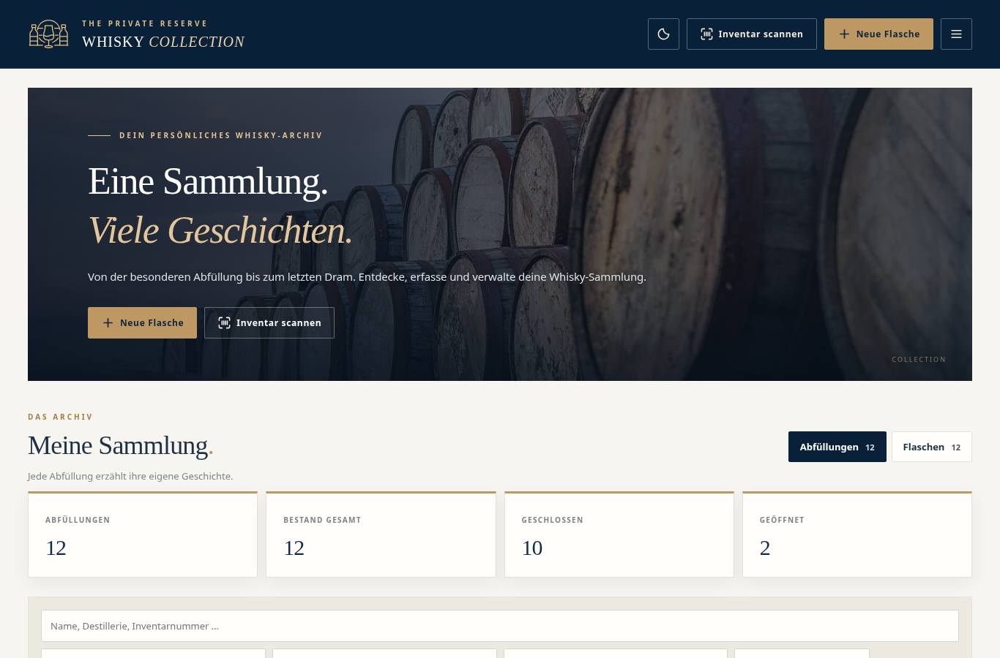
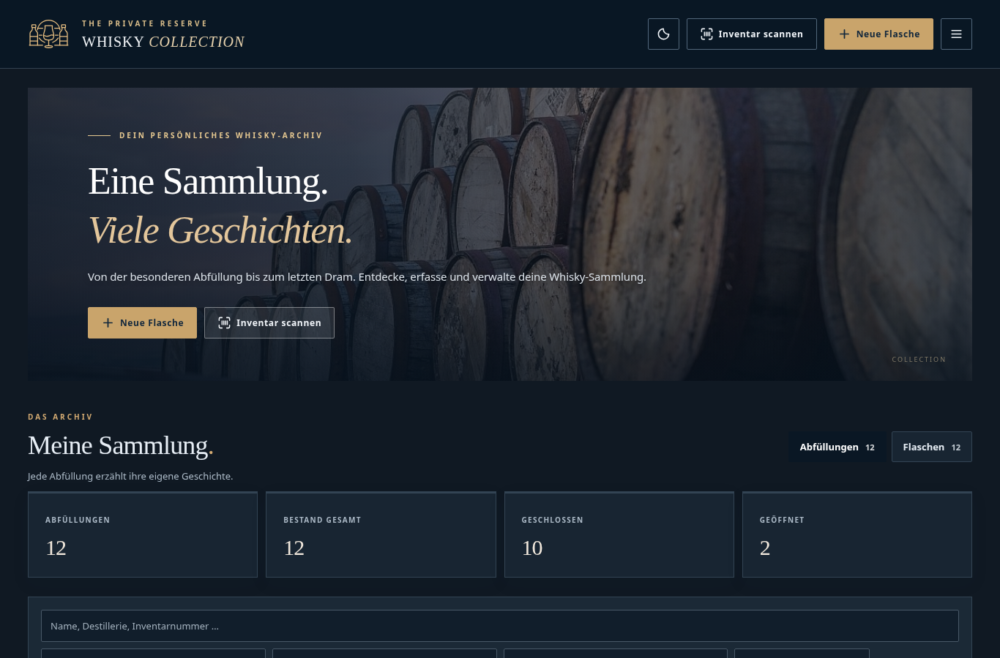

# Whisky Collection Manager v0.20.0

Lokale Webanwendung zur Verwaltung einer Whisky-Sammlung – von der Abfüllung über einzelne physische Flaschen bis zum Lagerfach. Eine Abfüllung kann mehrere Flaschen mit eigenen Inventarnummern, Zuständen, Fotos und Belegen enthalten.

Die Anwendung verwendet Node.js und Browser-ES-Module **ohne Datenbank und ohne Frontend-Build**. Sammlung und Lager werden in getrennten JSON-Dateien gespeichert. Sie läuft lokal oder auf einem Raspberry Pi als Docker-Container.

## Entwicklung und Code-Reviews

Die Anwendung wurde **vollständig durch ChatGPT programmiert**. Der Projektinitiator hat die Anforderungen formuliert und Korrekturen beziehungsweise Anpassungen angefordert, jedoch selbst keinen Anwendungscode geschrieben. Der Quellcode wird **regelmäßig mit Claude Code-Reviews unterzogen**.

## Funktionen

| Bereich | Umfang |
| --- | --- |
| **Sammlung** | Abfüllungen und physische Flaschen verwalten; Suche, Filter, Sortierung, Kachel- und Tabellenansicht sowie Scanner. |
| **Flaschen & Medien** | Inventarnummern, Zustände, Kauf- und Verkostungsdaten, Fotos, Belege und Anhänge. Nicht-destruktiver Fotoeditor mit optionaler lokaler KI-Freistellung. Fehlende Bilder werden durch ein einheitliches Flaschenmotiv ersetzt. |
| **Analyse** | Bestands-, Wert- und Sammlungsanalysen mit Filtern und Zeitaggregationen. |
| **Landkarte** | OpenStreetMap-Destilleriekarte mit Standorten, Clustern und Statusfiltern. |
| **Lager** | Räume, Möbel und Fächer; 2D- und 3D-Raumplan, virtuelle Regalwand, Fachinhalt-Modal sowie Einzel- und Mehrfach-Umlagerung. Import und Export von Raumplänen einschließlich optionaler Flaschenzuordnungen; bei belegten Räumen sichere Löschung mit vorheriger Freigabe aller Flaschen. |
| **Datensicherung** | Verschlüsselte AES-256-ZIP-Backups, manuell oder zeitgesteuert, für USB-, NAS- und Cloud-Ziele; Wiederherstellung nach Bestätigung. |
| **Oberfläche** | Responsive Light-/Darkmode-Oberfläche auf Deutsch und Englisch. |

In der 3D-Raumansicht öffnet ein Doppelklick auf ein **belegtes Fach** den Fachinhalt direkt im Raumplan. In der Regalansicht ist der Fachinhalt ebenfalls als Modal verfügbar. Die Flaschenkarten bieten direkt **Umlagern** und **Zur Detailseite** sowie vorhandene Flaschendaten; ein vorgeschaltetes verkürztes Detailmodal ist nicht nötig. Ein Doppelklick auf eine Flasche in der Regalwand oeffnet ihre Einzelvorschau. Verschachtelte Dialoge kehren beim Schliessen jeweils zur vorherigen Ansicht zurueck.

Ausführliche Funktions- und Bedienhinweise: [Lagerverwaltung](docs/LAGER.md), [Fotoeditor und Freistellung](docs/PHOTO_FREISTELLUNG.md), [Analysen](docs/ANALYSE.md), [Landkarte](docs/KARTE.md) und [Anforderungen](docs/ANFORDERUNGEN.md). Änderungen einzelner Versionen stehen ausschließlich im [Changelog](CHANGELOG.md).

## Einblicke in die Oberfläche

Die Screenshots zeigen Beispielansichten mit einer leeren Demo-Sammlung, keine privaten Daten.

| Desktop – hell | Desktop – dunkel |
| --- | --- |
|  |  |

<details>
<summary>Mobile Ansicht anzeigen</summary>


</details>

**2D-Raumplan mit Beispielmöbeln:**


## Lokal starten

**Voraussetzung:** Node.js 20 oder neuer. Im Repository-Verzeichnis:

```bash
npm start
```

Der Starthelfer installiert bei Bedarf npm-Abhängigkeiten, bereitet die lokalen KI-Dateien für die Freistellung vor, legt eine fehlende `.env` aus `.env.example` an und richtet bei Bedarf HTTPS-Zertifikate ein. Beim Start aus dem **normalen Quellcode-ZIP** ist dafür zunächst Internetzugang erforderlich. Das gesonderte Offline-Release-ZIP bringt die Pakete und KI-Dateien bereits mit. Für HTTPS wird `mkcert` oder OpenSSL benötigt. Vorhandene Konfigurationen werden nicht überschrieben.

Die Anwendung verwendet standardmäßig **HTTPS auf Port 3543**. Für ein Zertifikat mit einer bestimmten LAN-IP:

```bash
npm run https:setup -- --ip 192.168.178.50
npm start
```

Die Beispiel-IP durch die eigene Adresse ersetzen. Automatischen Server-Neustart beim Entwickeln bietet `npm run dev` (nach dem ersten `npm start`). Weiterführende Hinweise: [Entwicklung](docs/ENTWICKLUNG.md).

## Langfristige Offline-Wiederherstellung

GitHub Releases enthalten ab v0.20.0 neben dem Quellcode ein **Offline-Installations-ZIP mit npm-Paketcache und KI-Dateien** sowie archivierte Docker-Images fuer **ARM64 (Raspberry Pi)** und **AMD64**. Jedes Archiv hat eine SHA-256-Pruefsumme. Eine Neuinstallation aus den archivierten Artefakten ist ohne Paketserver, Modellhosting oder Container-Registry moeglich, sofern Node.js beziehungsweise Docker bereits auf dem Zielgeraet vorhanden sind. Die Datenbackups bleiben davon getrennt.

Die Offline-Artefakte lassen sich mit einem mitgelieferten Skript verifiziert auf denselben USB-/NAS-Datentraegern ablegen wie die bestehenden Backups. Vollstaendige Anleitung und Grenzen: [Offline-Releases](docs/OFFLINE_RELEASES.md).

## Raspberry Pi / Docker

**Voraussetzungen:** Raspberry Pi OS 64 Bit, Docker Engine mit Compose-Plugin, Git und OpenSSL. Für private GitHub-Repositories und Containerpakete muss der Zugriff eingerichtet sein.

```bash
git clone --branch main git@github.com:henryk86/whisky-collection-manager.git
cd whisky-collection-manager
cp deploy/.env.example .env
nano .env
sh deploy/setup-pi.sh
docker compose pull
docker compose up -d --remove-orphans
docker compose ps
```

Die App ist anschließend unter `https://<IP-des-Pi>:3543` erreichbar, sofern IP oder Hostname in der Zertifikatskonfiguration hinterlegt sind. Die Einrichtung verwendet einen Docker-Service `app` für Anwendung und Backup-Worker. Alle Sammlungs- und Lagerdaten sowie Fotos, Dokumente und Backups liegen **außerhalb des Repositorys** im über `WCM_DATA_DIR` konfigurierten Verzeichnis (standardmäßig `$HOME/whisky-collection-manager-data`). Container-Updates ersetzen diese Daten nicht.

**Sicherheit:** Es gibt **keinen allgemeinen Benutzerlogin**. Die App daher nur in einem vertrauenswürdigen Netz oder hinter zusätzlicher Zugriffskontrolle/VPN betreiben, nicht ungeschützt ins Internet freigeben. HTTPS allein ist keine Anmeldung. Für vollständige Sicherungen müssen Sammlung **und** Lager sowie Bilder und Dokumente enthalten sein.

### Updates

Vor dem Update ein geprüftes Backup erstellen. Bei der üblichen Git-/Docker-Installation:

```bash
git switch main
git pull --ff-only
docker compose pull
docker compose up -d --remove-orphans
```

Für reproduzierbare Deployments `IMAGE_TAG=vX.Y.Z` statt `latest` in `.env` setzen. Keine persistenten Datenverzeichnisse oder Docker-Volumes löschen; Quellcode-ZIPs sind kein Daten-Backup.

[Docker-Einrichtung, HTTPS, Host-Allowlist, Backupziele und Wiederherstellung](docs/DOCKER_BACKUP.md)

## Entwicklung und Tests

```bash
npm run check           # Syntax, Modulimporte, Sprachdateien und Dokumentationslinks
npm test                # Unit- und Integrationstests
npm run test:browser    # Browser-Tests (Playwright/Chromium erforderlich)
npm run release:check   # Versionskonsistenz
```

Der aktuelle Stand der tatsächlich durchgeführten Tests und offene Prüfungen sind in [TESTSTATUS](docs/TESTSTATUS.md) dokumentiert. Testhistorie: [TESTHISTORIE](docs/TESTHISTORIE.md). Browser- und Geräteprüfungen sind nicht durch die Node-Tests ersetzt.

Die Oberfläche ist auf Deutsch und Englisch lokalisiert. Die Sprachdateien liegen in [`public/locales`](public/locales/index.json); fachliche Konventionen und API-Verträge erläutern [Entwicklung](docs/ENTWICKLUNG.md) und [API](docs/API.md).

## Versionierung und Release

Entwicklung erfolgt auf `develop`. Ein erfolgreicher Pull Request nach `main` startet den GitHub-Release-Prozess mit Quellcode-ZIP und Docker-Image für AMD64/ARM64.

Kleine Änderungen erhöhen den **Patchlevel**, größere Erweiterungen die **Minor-Version**, inkompatible Änderungen die **Major-Version**:

```bash
npm run release:bump -- patch "Kurze Änderungsbeschreibung"
npm run release:check
npm run verify
```

[Release-Workflow](docs/RELEASE_WORKFLOW.md) · [Changelog](CHANGELOG.md)

## Dokumentation

| Dokument | Inhalt |
| --- | --- |
| [ARCHITEKTUR](docs/ARCHITEKTUR.md) | Module, Datenflüsse und Datenablage |
| [ANFORDERUNGEN](docs/ANFORDERUNGEN.md) | Fachliche Regeln und Funktionsumfang |
| [API](docs/API.md) | HTTP-Endpunkte und Datenformate |
| [LAGER](docs/LAGER.md) | Räume, Möbel, Fächer und Umlagerung |
| [PHOTO_FREISTELLUNG](docs/PHOTO_FREISTELLUNG.md) | Bildbearbeitung und KI-Freistellung |
| [ANALYSE](docs/ANALYSE.md) | Auswertungen und Zeitfilter |
| [KARTE](docs/KARTE.md) | Destilleriestandorte und Karte |
| [DOCKER_BACKUP](docs/DOCKER_BACKUP.md) | Docker, Sicherheit und Datensicherung |
| [ENTWICKLUNG](docs/ENTWICKLUNG.md) | Entwicklungsrichtlinien und Tests |
| [RELEASE_WORKFLOW](docs/RELEASE_WORKFLOW.md) | CI/CD und Versionierung |
| [TESTSTATUS](docs/TESTSTATUS.md) | Aktueller Prüfstand |
| [TECHNISCHE_SCHULDEN](docs/TECHNISCHE_SCHULDEN.md) | Bekannte offene Punkte |

Lizenz: [MIT](LICENSE). Mitgelieferte Fremdbibliotheken und Medien können eigenen Lizenzbedingungen unterliegen.
