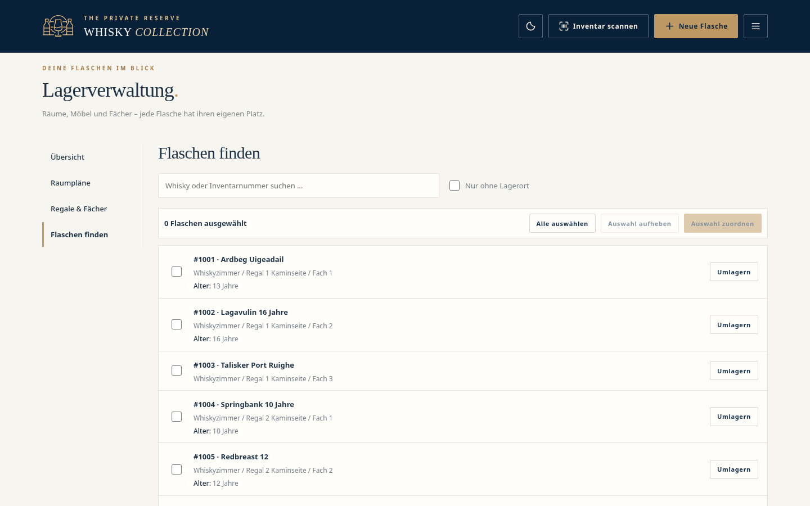

# Whisky Collection Manager v1.12.4

Webanwendung zur lokalen Verwaltung einer Whisky-Sammlung mit einzelnen Flaschen, Verkostungen und Lagerplätzen. Die Anwendung basiert auf Node.js und Browser-ES-Modulen, benötigt keine Datenbank und keinen Frontend-Build. Sammlung und Lager werden in JSON-Dateien gespeichert.


## Funktionen

- **Sammlung und Flaschen:** Abfüllungen, Standard- und Sample-Flaschen, Inventarnummern, Kauf- und Lagerdaten, Suche, Filter und Scanner.
- **Verkostungen:** Unabhängig oder einer Abfüllung zugeordnet; Bewertungen mit Kommentar, Geschmacksprofile sowie Notizen zu Nase, Geschmack und Abgang.
- **Intelligente Tasting-Flight-Planung:** Vier Strategien kombinieren Geschmacksprofile, Fassarten und Alter und optimieren die Verkostungsreihenfolge. [Planungslogik und Formeln](docs/FLIGHT_PLANUNG.md).
- **Fotos und Nachweise:** Flaschenfotos bearbeiten und sortieren, optionale lokale KI-Freistellung; Dokumente je physischer Flasche mit Vorschau und Download.
- **Lager:** Räume, Möbel und Fächer, Umlagerungen, Flaschensuche und Raumpläne in 2D und 3D.
- **Analysen und Karte:** Sammlungs- und Wertauswertungen sowie eine Destilleriekarte mit OpenStreetMap.
- **Datensicherung:** Verschlüsselte Backups mit geplanten Sicherungen, verschiedenen Speicherzielen und Wiederherstellung.
- **Oberfläche und Zugriff:** Responsive, Deutsch/Englisch, Hell-/Dunkelmodus und optionale Anmeldung mit Nutzerverwaltung.

## Oberfläche

Die Abbildungen zeigen Beispieldaten ohne private Sammlungsdaten. Für die Lageransichten wurde das Raumlayout eines Whiskyzimmers mit einer auf insgesamt **50 Flaschenplätze** reduzierten Demo-Kapazität verwendet.

| Sammlung – hell | Sammlung – dunkel |
| --- | --- |
|  |  |

<details>
<summary>Mobile Sammlungsansicht</summary>


</details>

**Whiskyzimmer – 3D-Raumansicht**


<details>
<summary>2D-Raumplan und Regalansicht anzeigen</summary>

| Raumplan (2D) | Regale und Fächer |
| --- | --- |
|  |  |

</details>

**Weitere Ansichten**

| Flaschen finden | Analysen |
| --- | --- |
|  |  |

**Destillerie-Karte**


## Installation und Betrieb

### Lokal starten

**Voraussetzung:** Node.js 20 oder neuer; für die erstmalige HTTPS-Zertifikatserstellung OpenSSL oder `mkcert`.

```bash
npm start
```

Der Starthelfer installiert bei Bedarf npm-Abhängigkeiten, bereitet die lokalen KI-Dateien vor und erstellt eine fehlende `.env` sowie Standard-HTTPS-Zertifikate. Beim ersten Start kann dafür Internetzugang erforderlich sein. Die Anwendung ist standardmäßig über **`https://localhost:3543`** erreichbar. Für den Zugriff über eine andere IP oder einen Hostnamen muss das Zertifikat entsprechend eingerichtet werden.

Details: [Lokale Entwicklung und HTTPS](docs/ENTWICKLUNG.md) · [Offline-Installation](docs/OFFLINE_RELEASES.md).

### Raspberry Pi und Docker

**Voraussetzungen:** Raspberry Pi OS (64 Bit), Docker Engine mit Compose-Plugin, Git und OpenSSL.

```bash
git clone --branch main https://github.com/henryk86/whisky-collection-manager.git
cd whisky-collection-manager
cp deploy/.env.example .env
# In .env die eigenen CERT_IP_ADDRESSES / CERT_DNS_NAMES eintragen.
sh deploy/setup-pi.sh
docker compose pull
docker compose up -d --remove-orphans
```

Anschließend ist die Anwendung unter **`https://<IP-des-Pi>:3543`** erreichbar, sofern die IP im Zertifikat eingetragen ist. Der externe HTTPS-Port lässt sich über `HTTPS_PUBLIC_PORT` ändern (auch auf `443`). Optional sind öffentlich vertrauenswürdige Zertifikate über Certbot mit DNS-01 möglich: [Let's Encrypt einrichten](docs/LETS_ENCRYPT.md).

Sammlungsdaten werden außerhalb des Repositorys gespeichert und bleiben bei Container-Updates erhalten. Vor Updates wird trotzdem ein vollständiges Backup empfohlen. Weitere Anleitungen: [Docker, Updates und Datensicherung](docs/DOCKER_BACKUP.md) · [Offline-Releases](docs/OFFLINE_RELEASES.md).

### Anmeldung und Sicherheit

Die **Loginpflicht ist standardmäßig deaktiviert**. Unter **Einstellungen → Nutzerverwaltung** kann sie durch einen Administrator aktiviert werden. Bei öffentlich erreichbaren Installationen sind Loginpflicht und HTTPS erforderlich; eine zusätzliche Netzabsicherung oder ein VPN wird empfohlen. Weitere Nutzer können die Sammlung verwalten, aber nicht die Nutzerverwaltung öffnen.

Beim ersten Start wird `admin` mit einem **individuellen Startpasswort** angelegt; es steht einmalig in den Serverlogs (`docker compose logs app`). Bei der ersten Anmeldung ist ein Passwortwechsel Pflicht. Die Konten liegen in `data/user.json`, Passwörter nur als gesalzene scrypt-Hashes. Zugang, Passwortwiederherstellung und Betrieb: [Anmeldung und Nutzerverwaltung](docs/ANMELDUNG.md).

## Entwicklung und Releases

Änderungen werden auf `develop` gesammelt. Die Versionsnummer wird erst beim manuell freigegebenen Release-Merge nach `main` automatisch festgelegt; `main` ist der geschützte Standardbranch. Für lokale Commits sind Conventional-Commit-Nachrichten vorgesehen.

```bash
npm run hooks:install  # Commit-Nachrichten lokal prüfen (einmal pro Klon)
npm run check          # Syntax, Module, Übersetzungen und Dokumentationslinks
npm test               # Unit- und Integrationstests
npm run test:browser   # Browser-Tests mit Playwright/Chromium
```

Die CI führt die relevanten Prüfungen aus. Nur tatsächlich betroffene aktuelle Dokumentation wird im gesamten PR angepasst; einzelne Commits benötigen keine eigene Dokumentation oder Begründung. Die PR-Beschreibung darf leer bleiben und wird nicht von CI geprüft. Der Release-Prozess und die Versionssynchronisierung sind in [Release-Workflow](docs/RELEASE_WORKFLOW.md) dokumentiert; Testergebnisse stehen in [Teststatus](docs/TESTSTATUS.md), Änderungen im [Changelog](CHANGELOG.md).

## Weitere Dokumentation

- **Funktionen:** [Anforderungen](docs/ANFORDERUNGEN.md), [Lager](docs/LAGER.md), [Geschmacksprofil](docs/GESCHMACKSPROFIL.md), [Fotoeditor](docs/PHOTO_FREISTELLUNG.md), [Analysen](docs/ANALYSE.md), [Karte](docs/KARTE.md).
- **Technik:** [Architektur](docs/ARCHITEKTUR.md), [API](docs/API.md), [Entwicklung](docs/ENTWICKLUNG.md), [Teststrategie](docs/TESTSTRATEGIE.md), [technische Schulden](docs/TECHNISCHE_SCHULDEN.md).

Lizenz: [MIT](LICENSE). Für mitgelieferte Fremdbibliotheken und Medien können weitere Lizenzbedingungen gelten.
