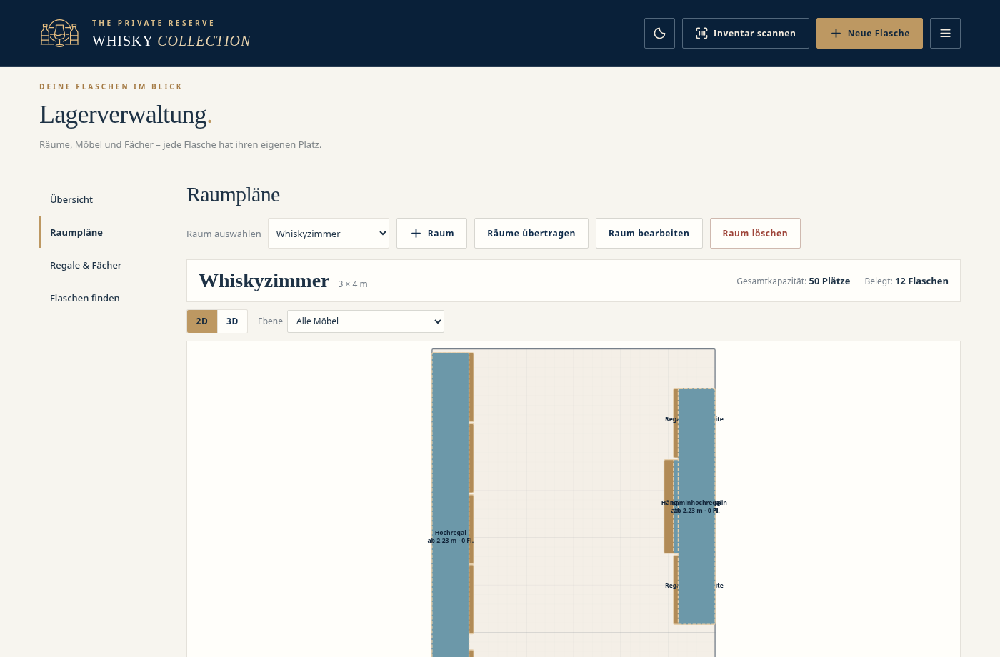
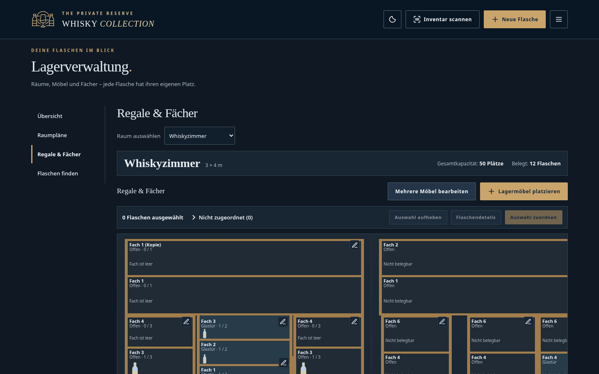
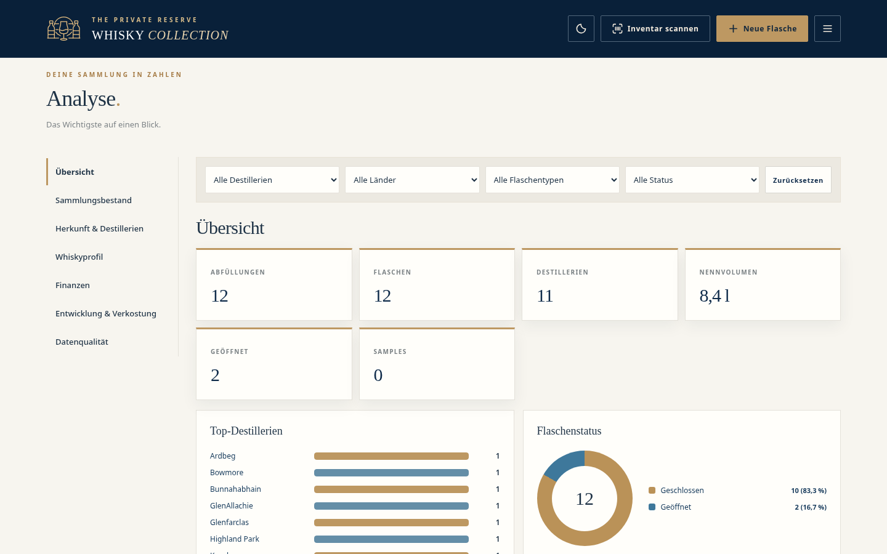
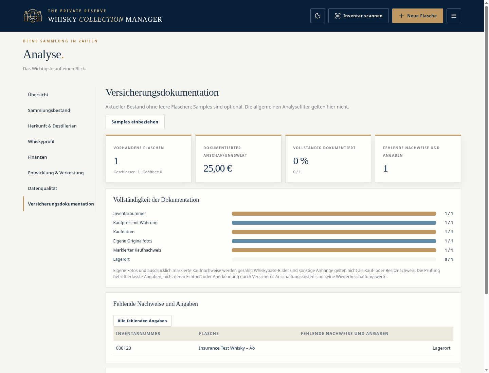
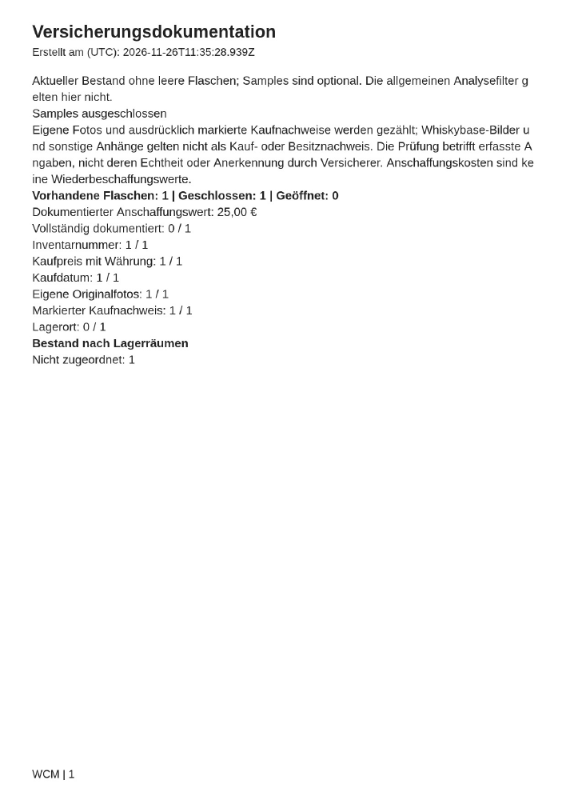
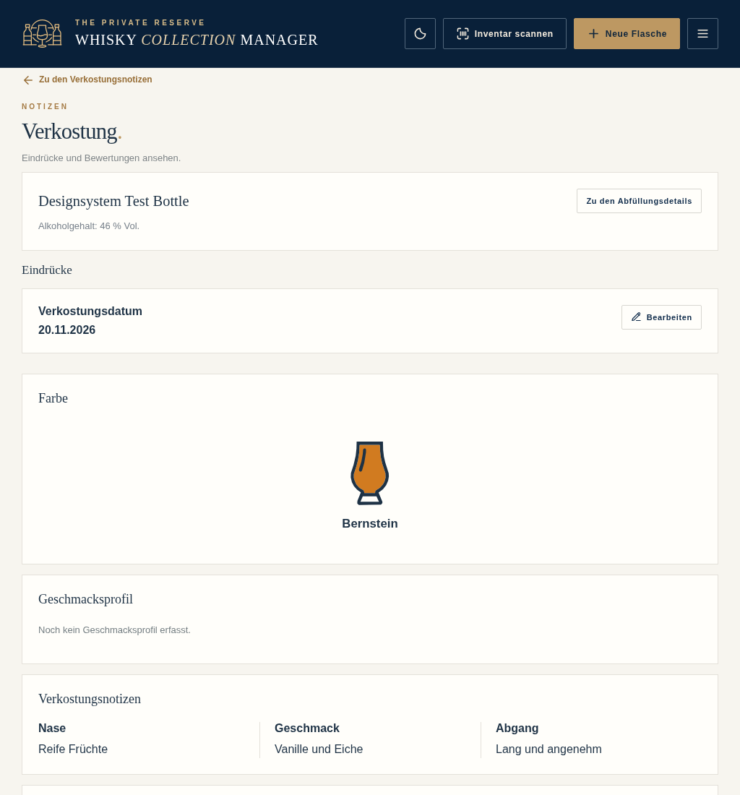
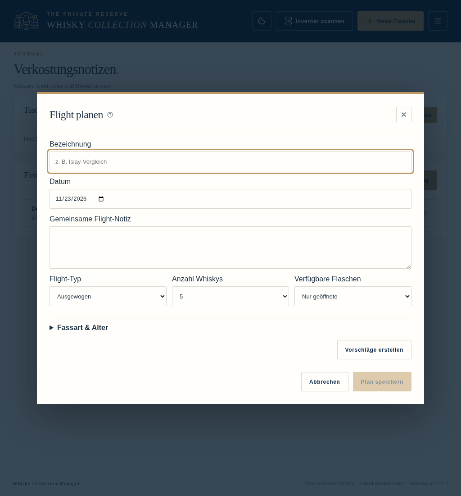

# Whisky Collection Manager v1.14.1

<p align="center">
  
</p>

<p align="center"><strong>Deine Sammlung. Deine Nachweise. Deine Daten.</strong></p>

<p align="center">
  <a href="README.md">Deutsch</a> · <a href="README.en.md">English</a>
</p>

<p align="center">
  <a href="https://github.com/henryk86/whisky-collection-manager/releases/latest"></a>
  <a href="LICENSE"></a>
</p>

Whisky Collection Manager (WCM) ist eine selbst gehostete Webanwendung zur lokalen Verwaltung einer Whisky-Sammlung. Sie verbindet **Bestandsverwaltung, Versicherungsdokumentation, Verkostungsnotizen, Tasting-Flights, Lagerplanung und verschlüsselte Backups** in einer Anwendung – ohne Datenbank und ohne Frontend-Build.

Alle Daten werden lokal in versionierten JSON-Dateien gespeichert. WCM eignet sich besonders für Sammler, die ihren Bestand **nachvollziehbar dokumentieren** und bei Bedarf durch Fotos, Rechnungen und Bestandsberichte gegenüber der eigenen Versicherung belegen möchten.

## Warum WCM?

- **Versicherungsdokumentation statt nur Inventarliste:** Inventarnummern, Flaschenfotos, Kaufdaten, Kaufnachweis-Markierungen sowie PDF- und ZIP-Exporte für die eigene Dokumentation.
- **Physische Lagerverwaltung:** Räume, Möbel, Fächer, 2D- und 3D-Ansichten sowie Flaschensuche nach Lagerort.
- **Verkostung und Planung:** Freie und flaschenbezogene Tastings, Geschmacksprofile, Notizen und intelligente Tasting-Flight-Planung.
- **Self-hosted und datenhoheitlich:** Keine Cloudpflicht, keine Datenbank, verschlüsselte Backups und Offline-Releases.

## Funktionsüberblick

| Bereich | Highlights |
| --- | --- |
| Sammlung und Flaschen | Abfüllungen, Standard- und Sample-Flaschen, Inventarnummern, Kauf- und Lagerdaten, Suche, Filter und Scanner |
| Verkostungen | Unabhängig oder einer Abfüllung zugeordnet; Bewertungen mit Kommentar, Geschmacksprofil sowie Notizen zu Nase, Geschmack und Abgang |
| Tasting-Flights | Mehrere Planungsstrategien, gemeinsame Flight-Notiz, Verfügbarkeitsfilter und optimierte Verkostungsreihenfolge |
| Fotos und Nachweise | Flaschenfotos bearbeiten und sortieren, optionale lokale KI-Freistellung; Dokumente je physischer Flasche mit Vorschau und Download |
| Lager | Räume, Möbel und Fächer, Umlagerungen, Flaschensuche und Raumpläne in 2D und 3D |
| Versicherungsdokumentation | Nachweisvollständigkeit pro physischer Flasche, Kaufnachweis-Markierungen, PDF-Berichte und ZIP-Paket mit Originalen |
| Analysen und Karte | Sammlungs- und Wertauswertungen sowie eine Destilleriekarte mit OpenStreetMap |
| Datensicherung | Verschlüsselte Backups mit geplanten Sicherungen, verschiedenen Speicherzielen und Wiederherstellung |
| Oberfläche und Zugriff | Responsive, Deutsch/Englisch, Hell-/Dunkelmodus und optionale Anmeldung mit Nutzerverwaltung |

## Oberfläche

Die Abbildungen zeigen Beispieldaten ohne private Sammlungsdaten. Für die Lageransichten wurde das Raumlayout eines Whiskyzimmers mit einer auf insgesamt **50 Flaschenplätze** reduzierten Demo-Kapazität verwendet.

| Sammlung – hell | Sammlung – dunkel |
| --- | --- |
|  |  |

<details>
<summary>Mobile Sammlungsansicht</summary>


</details>

**Whiskyzimmer – 3D-Raumansicht**


<details>
<summary>2D-Raumplan und Regalansicht anzeigen</summary>

| Raumplan (2D) | Regale und Fächer |
| --- | --- |
|  |  |

</details>

**Weitere Ansichten**

| Flaschen finden | Analysen |
| --- | --- |
|  |  |

**Versicherungsdokumentation**

| Nachweisprüfung | Versicherungsreport |
| --- | --- |
|  |  |

**Verkostung und Flight-Planung**



<details>
<summary>Tasting-Flight-Planung anzeigen</summary>



</details>

**Destillerie-Karte**


## Installation und Betrieb

### Schnellstart-Optionen

| Szenario | Geeignet für | Einstieg |
| --- | --- | --- |
| **Lokal auf Windows/macOS/Linux** | Einzelplatzbetrieb auf dem eigenen Rechner | `npm start` |
| **Docker** | Dauerbetrieb auf Server oder NAS | `docker compose up -d` |
| **Raspberry Pi** | Energieeffizienter Heimserver | `sh deploy/setup-pi.sh` |
| **Offline-Release** | Installation ohne laufenden Paketdownload | [Offline-Releases](docs/OFFLINE_RELEASES.md) |

### Lokal starten

**Voraussetzung:** Node.js 20 oder neuer; für die erstmalige HTTPS-Zertifikatserstellung OpenSSL oder `mkcert`.

```bash
npm start
```

Der Starthelfer installiert bei Bedarf npm-Abhängigkeiten, bereitet die lokalen KI-Dateien vor und erstellt eine fehlende `.env` sowie Standard-HTTPS-Zertifikate. Beim ersten Start kann dafür Internetzugang erforderlich sein. Die Anwendung ist standardmäßig über **`https://localhost:3543`** erreichbar.

Details: [Lokale Entwicklung und HTTPS](docs/ENTWICKLUNG.md) · [Offline-Installation](docs/OFFLINE_RELEASES.md).

### Docker und Raspberry Pi

**Voraussetzungen:** Docker Engine mit Compose-Plugin, Git und OpenSSL. Auf dem Raspberry Pi wird Raspberry Pi OS (64 Bit) empfohlen.

```bash
git clone --branch main https://github.com/henryk86/whisky-collection-manager.git
cd whisky-collection-manager
cp deploy/.env.example .env
# In .env die eigenen CERT_IP_ADDRESSES / CERT_DNS_NAMES eintragen.
sh deploy/setup-pi.sh
docker compose pull
docker compose up -d --remove-orphans
```

Anschließend ist die Anwendung unter **`https://<IP-or-host>:3543`** erreichbar, sofern die Adresse im Zertifikat eingetragen ist. Der externe HTTPS-Port lässt sich über `HTTPS_PUBLIC_PORT` ändern. Optional sind öffentlich vertrauenswürdige Zertifikate über Certbot mit DNS-01 möglich: [Let's Encrypt einrichten](docs/LETS_ENCRYPT.md).

Weitere Anleitungen: [Docker, Updates und Datensicherung](docs/DOCKER_BACKUP.md) · [Offline-Releases](docs/OFFLINE_RELEASES.md).

### Anmeldung und Sicherheit

Die **Loginpflicht ist standardmäßig deaktiviert**. Unter **Einstellungen → Nutzerverwaltung** kann sie durch einen Administrator aktiviert werden. WCM ist für den Betrieb im vertrauenswürdigen privaten Netzwerk oder über VPN vorgesehen. Eine direkte Veröffentlichung im Internet wird auch mit aktivierter Anmeldung und HTTPS nicht empfohlen.

Beim ersten Start wird `admin` mit einem **individuellen Startpasswort** angelegt; es steht einmalig in den Serverlogs (`docker compose logs app`). Bei der ersten Anmeldung ist ein Passwortwechsel Pflicht. Die Konten liegen in `data/user.json`, Passwörter nur als gesalzene scrypt-Hashes.

Mehr dazu: [Anmeldung und Nutzerverwaltung](docs/ANMELDUNG.md) · [Security policy](SECURITY.md).

## Entwicklung und Releases

Änderungen werden auf `develop` gesammelt. Die Versionsnummer wird erst beim manuell freigegebenen Release-Merge nach `main` automatisch festgelegt; `main` ist der geschützte Standardbranch. Für lokale Commits sind Conventional-Commit-Nachrichten vorgesehen.

```bash
npm run hooks:install  # Commit-Nachrichten lokal prüfen (einmal pro Klon)
npm run check          # Syntax, Module, Übersetzungen und Dokumentationslinks
npm test               # Unit- und Integrationstests ohne Browser
npx playwright-core install --with-deps chromium
npm run test:browser   # Browser-Tests mit Playwright/Chromium
```

Die CI führt die relevanten Prüfungen aus. Nur tatsächlich betroffene aktuelle Dokumentation wird im gesamten PR angepasst; einzelne Commits benötigen keine eigene Dokumentation oder Begründung. Die PR-Beschreibung darf leer bleiben und wird nicht von CI geprüft.

Der Release-Prozess und die Versionssynchronisierung sind in [Release-Workflow](docs/RELEASE_WORKFLOW.md) dokumentiert; Testergebnisse stehen in [Teststatus](docs/TESTSTATUS.md), Änderungen im [Changelog](CHANGELOG.md).

## Weitere Dokumentation

- **Funktionen:** [Anforderungen](docs/ANFORDERUNGEN.md), [Lager](docs/LAGER.md), [Geschmacksprofil](docs/GESCHMACKSPROFIL.md), [Fotoeditor](docs/PHOTO_FREISTELLUNG.md), [Analysen](docs/ANALYSE.md), [Karte](docs/KARTE.md).
- **Technik:** [Architektur](docs/ARCHITEKTUR.md), [API](docs/API.md), [Entwicklung](docs/ENTWICKLUNG.md), [Teststrategie](docs/TESTSTRATEGIE.md), [technische Schulden](docs/TECHNISCHE_SCHULDEN.md).
- **Repository-Präsentation:** [GitHub repository profile](docs/GITHUB_REPOSITORY_PROFILE.md).

Lizenz: [MIT](LICENSE). Für mitgelieferte Fremdbibliotheken und Medien können weitere Lizenzbedingungen gelten.
