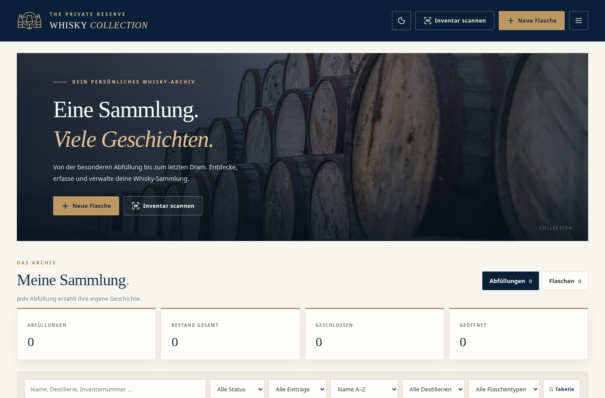
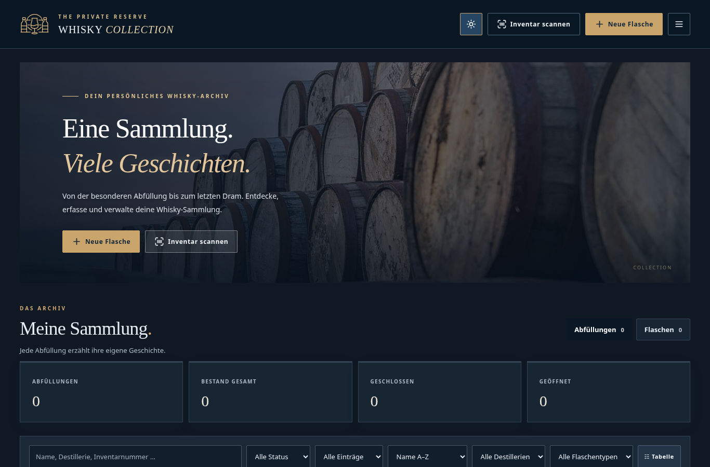
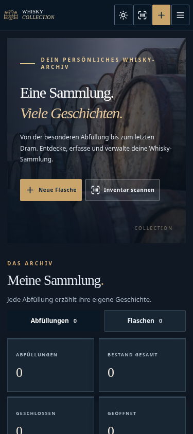
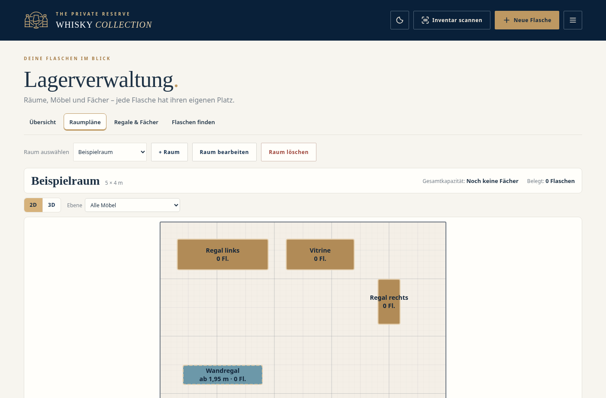

# Whisky Collection Manager v0.17.12

Lokale Webanwendung zur Verwaltung einer Whisky-Sammlung – von der **Abfüllung** über einzelne **physische Flaschen** bis zum **Lagerfach**. Eine Abfüllung kann mehrere Flaschen mit unterschiedlichen Inventarnummern, Zuständen, Größen, Fotos und Belegen enthalten.

Die Anwendung nutzt Node.js und Browser-ES-Module, **ohne Datenbank und ohne Frontend-Build**. Sammlungs- und Lagerdaten werden in zwei JSON-Dateien gespeichert. Sie kann lokal oder auf einem Raspberry Pi 4 als Docker-Container betrieben werden.

## Funktionen im Überblick

| Bereich | Umfang |
| --- | --- |
| **Sammlung** | Abfüllungen und physische Flaschen erfassen, suchen, filtern, sortieren; Kachel-/Tabellenansicht und Scanner. Inventarnummern bleiben bei gleichzeitiger Belegung eindeutig, früher verwendete Nummern dürfen nach Freigabe erneut manuell zugeteilt werden. |
| **Details & Medien** | Destillerien, Kauf-/Verkostungsdaten, Fotos mit nicht-destruktivem Editor (Belichtung, Lichter/Tiefen, Kontrast, Weißabgleich inklusive Pipette für neutrale Bildbereiche, Details, gruppenweises Zurücksetzen, Vorher/Nachher und automatische Korrektur) und optionaler lokaler KI-Freistellung mit Original-Erhalt sowie Sortierung per Maus/Touch-Griff oder Pfeilbuttons, Rechnungen und andere Anhänge je Flasche. Vorschau für explizit übergebene, strukturierte Abfüllungsdaten (ohne öffentlich mitgelieferte Erweiterung). |
| **Analyse** | Übersicht und sechs Themenbereiche mit insgesamt 38 Auswertungen, Filtern und Zeitaggregationen. |
| **Landkarte** | OpenStreetMap, Destilleriekatalog, manuell gepflegte Standorte, Cluster und Filter für aktive/geschlossene Destillerien. |
| **Lager** | Räume, Möbel und Fächer mit Zuordnung einzelner Flaschen. Klick auf eine Flasche im Fach zeigt ein Detail-Modal mit Link zur markierten Flasche auf der Detailseite und separater Umlagern-Aktion. 2D-Grundriss (10-cm-Raster) und Three.js-3D-Ansicht; getrennte Höhenebenen, Kollisionsprüfung, Möbel-/Fachbearbeitung und Mehrfachaktionen. |
| **Sicherung** | Geschützte AES-256-ZIP-Backups manuell oder zeitgesteuert auf USB, NAS und Rclone-Ziele; Prüfung und bestätigte Wiederherstellung. |
| **Oberfläche** | Responsive Light-/Darkmode-Oberfläche; Deutsch und Englisch über semantische Sprachschlüssel. |

Die Importvorschau verwendet nun einen **quellunabhängigen Formularablauf**: Auswahl der Felder, Destillerie-Abgleich und Zuordnung eines Referenzfotos sind getrennt von der Validierung des jeweiligen Katalogformats. Vorhandene Importlinks, gespeicherte Quellenangaben und die optionale Browser-Erweiterung bleiben kompatibel. Weitere Details stehen unter [Externe Importdaten](docs/ARCHITEKTUR.md#externe-importdaten).

Die [automatische Flaschenfreistellung](docs/PHOTO_FREISTELLUNG.md) arbeitet ohne externen KI-Dienst, entfernt abgetrennte Maskenreste, richtet leicht bis mäßig schiefe Flaschen (bis 20° erkannte Neigung) anhand ihrer Hauptachse gerade aus und beschneidet das transparente Ergebnis oben und unten ohne gewollten Rand auf **2:3** und reduziert breite halbtransparente Farbsäume entlang der Flaschenkontur. Original- und Freistellungsbild bleiben getrennt. Freistellung und Bildkorrekturen teilen sich seit v0.17.2 einen Editor mit genau **einer Bildvorschau**, auch auf Smartphones. Das **Stift-Symbol** am Flaschenbild öffnet diesen Editor mit reversiblen Korrekturwerten. Bei einer Freistellung nach einer Bearbeitung werden dieselben Korrekturen auf das transparente Ergebnis übernommen; Original und Freistellung besitzen getrennte editierbare WebP-Ableitungen. Die Bildbearbeitung und Freistellmaske sind als **zwei Tabs rechts neben der unveränderten Bildvorschau** organisiert; die Pinselwerkzeuge befinden sich im Tab *Freistellung*. Der Bildausschnitt bleibt beim Tabwechsel gleich groß. Freistellungen werden mit möglichst unveränderter Quellauflösung bis 4096 px Höhe erzeugt; das Backend-Limit von 10 MB pro Bild kann eine Reduzierung erzwingen. Die Bildvorschau lässt sich zum Prüfen von Details bis auf 600 % vergrößern (ohne Einfluss auf den Export). Ein Pinsel kann die Freistellungsmaske lokal radieren, versehentlich radierte Anteile wiederherstellen und einzelne Pinselstriche rückgängig machen. Details und Einschränkungen sind in [Flaschenfoto-Bearbeitung](docs/PHOTO_FREISTELLUNG.md#bildkorrekturen-ab-v0170) dokumentiert.

Die technischen und fachlichen Details stehen in [ANALYSE](docs/ANALYSE.md), [KARTE](docs/KARTE.md), [LAGER](docs/LAGER.md) und [ANFORDERUNGEN](docs/ANFORDERUNGEN.md). Die [Architekturübersicht](docs/ARCHITEKTUR.md) erklärt den Aufbau und die Zuständigkeiten der Module.

## Einblicke in die Oberfläche

Die folgenden Screenshots zeigen die tatsächliche Oberfläche mit einer **leeren Demo-Sammlung** (keine privaten Flaschen- oder Lagerdaten). Auf GitHub lassen sich die Bilder direkt anzeigen.

| Desktop – hell | Desktop – dunkel |
| --- | --- |
|  |  |

<details>
<summary>Mobile Ansicht anzeigen</summary>



</details>

**Lagerverwaltung – 2D-Raumplan mit Beispielmöbeln:**



Die Screenshots zeigen Beispielansichten, keine produktive Sammlung. Die 3D-Raumansicht, Landkarte und Analyse bieten weitere Ansichten.

## Raspberry Pi 4 / Docker

**Voraussetzungen:** Raspberry Pi OS 64 Bit, Docker Engine mit Compose-Plugin, Git und OpenSSL. Für private GitHub-Repositories und GHCR-Pakete muss der entsprechende Zugriff eingerichtet sein.

```bash
git clone --branch main git@github.com:henryk86/whisky-collection-manager.git
cd whisky-collection-manager
cp deploy/.env.example .env
nano .env
sh deploy/setup-pi.sh
docker compose config
docker compose pull
docker compose up -d --remove-orphans
docker compose ps
```

Den Repository-Host beziehungsweise SSH-Alias bei Bedarf anpassen. Die Installation verwendet **einen Service `app`** (App und Backup-Worker), standardmäßig **HTTPS auf Port 3543**. Im Browser `https://<IP-des-Pi>:3543` öffnen. Die IP und erreichbare Hostnamen müssen zur Zertifikatskonfiguration in `.env` passen. Die Vorlage ist [`deploy/.env.example`](deploy/.env.example).

### Daten und Sicherheit

Das Setup legt `WCM_DATA_DIR` außerhalb des Git-Checkouts fest (Standard: `$HOME/whisky-collection-manager-data`). Diese Verzeichnisse sind persistent und werden **nicht** durch ein Image-Update ersetzt:

```text
${WCM_DATA_DIR}/storage/data/collection.json   Sammlung
${WCM_DATA_DIR}/storage/data/warehouse.json    Lager (separates Schema)
${WCM_DATA_DIR}/storage/images/                Fotos
${WCM_DATA_DIR}/storage/documents/             Belege/Anhänge
${WCM_DATA_DIR}/storage/backups/               Sicherheitskopien
${WCM_DATA_DIR}/backup-control/                Backup-Einstellungen und -Passwort
${WCM_DATA_DIR}/backup-targets/                USB-/NAS-Ziele
${WCM_DATA_DIR}/rclone/                        Cloud-Konfiguration
${WCM_DATA_DIR}/secrets/                        Zertifikate und Admin-Token
```

**Die Anwendung besitzt keinen allgemeinen Benutzerlogin.** Sie darf daher nur in einem vertrauenswürdigen Netz oder hinter zusätzlicher Zugriffskontrolle/VPN betrieben werden. Keine Router-Portfreigabe für den Container einrichten. HTTPS ersetzt keine Authentifizierung. Ein vollständiges Backup umfasst **beide JSON-Dateien** sowie Fotos und Dokumente; ein reiner Collection-JSON-Export enthält **keine** Lagerdaten.

**Sicherheit seit v0.15.10:** Schreib-APIs verlangen JSON und werden gegen fremde Browser-Origins geprueft. Eine HTTP-Host-Allowlist erlaubt standardmaessig Loopback und die DNS-/IP-Namen des HTTPS-Zertifikats. Weitere Hostnamen fuer zusätzliche Zugriffsadressen unter `ALLOWED_HOSTS` in `.env` ergaenzen. Zugriffe externer Browser-Erweiterungen koennen optional durch `EXTENSION_IDS` auf konkrete IDs beschraenkt werden; WCM selbst liefert keine Erweiterung aus. Die App bleibt trotz dieser Schutzmassnahmen **ohne allgemeinen Login**. Bei nicht erlaubtem Host gibt der Server HTTP 421 zurück und protokolliert einmalig den abgelehnten Namen. Nach 20 verschiedenen abgelehnten Namen weist eine einmalige Warnung darauf hin, dass weitere Hostnamen nicht mehr einzeln im Log erscheinen.

[Umsetzung des Sicherheitsreviews](docs/CODE_REVIEW_0159.md), [Nachpruefung v0.15.10](docs/CODE_REVIEW_01510_FOLLOWUP.md) und [Docker, TLS, USB/NAS/Cloud und Restore im Detail](docs/DOCKER_BACKUP.md)

### Updates auf dem Pi

**Container-Basis seit v0.16.6:** Debian Slim (`node:22-bookworm-slim`)
anstelle von Alpine; der Wechsel umgeht die auf Raspberry Pi 4 ARM64
beobachtete Node.js-Inkompatibilitaet der bisherigen Laufzeitbasis. Der praktische
App-Start auf dem Pi muss nach Veröffentlichung noch verifiziert werden.
Zur Kontrolle `docker compose run --rm --no-deps --entrypoint node app --version`
ausfuehren. Weitere Details: [Docker und Raspberry Pi](docs/DOCKER_BACKUP.md).

**Wichtig beim Update von Versionen vor v0.15.10:** Vor dem Container-Update
in `.env` pruefen, ob die im Browser tatsaechlich verwendete Pi-IP und alle
LAN-/Router-Namen in `CERT_IP_ADDRESSES`, `CERT_DNS_NAMES` oder `ALLOWED_HOSTS`
stehen. Alte Installationen, DHCP-Wechsel oder ein Router-Alias können sonst
zu **HTTP 421** fuehren, obwohl die Adresse zuvor erreichbar war.
Die beim Start ausgegebene Liste `Erlaubte Hosts: ...` sowie die einmalige
Warnung `Abgelehnter HTTP-Host: ...` helfen bei der Diagnose (`docker compose logs app`).
Fehlende Adressen in `.env` eintragen und den Container mit
`docker compose up -d --force-recreate app` neu erstellen.
Bei neuen Zertifikatsnamen/-IPs auch das Zertifikat erneuern
(`sh deploy/setup-pi.sh --renew-cert`); allein `ALLOWED_HOSTS` erneuert
**kein** TLS-Zertifikat.

**Reverse Proxy:** Der Proxy muss zum WCM-Backend **HTTPS** verwenden,
den urspruenglichen `Host`-Header erhalten und diesen Namen in der Allowlist
haben. Nur TLS am Proxy und anschliessend HTTP zum Backend wird von der
Origin-Pruefung derzeit nicht unterstuetzt (403 bei Schreibzugriffen).
`X-Forwarded-Proto` wird absichtlich nicht vertraut.

```bash
git switch main
git pull --ff-only
docker compose pull
docker compose up -d --remove-orphans
docker compose ps
```

Für reproduzierbare Deployments `IMAGE_TAG=vX.Y.Z` statt `latest` in `.env` setzen. Vor Updates ein externes, testweise geprüftes Backup aufbewahren. Niemals bestehende Datenordner durch Dateien aus einem Quellcode-ZIP ersetzen.

## Umstieg von v0.17.10 auf v0.17.11 oder neuer

Beim Entpacken eines neuen Quellcode-ZIPs **über** ein vorhandenes Git-Arbeitsverzeichnis werden zuvor verschobene Dateien nicht automatisch gelöscht. Aus v0.17.10 können insbesondere diese inzwischen überflüssigen Dateien zurückbleiben:

```powershell
# Im Repository-Stammverzeichnis: alte, in Git verfolgte Importmodule entfernen
git rm -- public/js/features/whiskybase/choice-template.js public/js/features/whiskybase/distillery-matching.js
npm run check
```

Bei einem vollständig neuen Checkout sind diese Dateien nicht vorhanden und der Schritt entfällt. Die Module liegen seit v0.17.11 unter `public/js/features/import/`. Wenn die alte `choice-template.js` erhalten bleibt, wird `whiskybase.import.choiceNotFound` weiter referenziert, obwohl der neue Übersetzungsschlüssel `imports.preview.choiceNotFound` lautet. Die korrekte Lösung ist das **Entfernen der alten Dateien**, nicht das Wiederherstellen des alten Übersetzungsschlüssels. Git muss die Löschungen als Änderungen sehen und mit dem Patch committen.

## Lokal entwickeln

**Node.js 20 oder neuer** ist erforderlich. Es gibt keine Datenbank und keinen Frontend-Bundler. Für die optionale lokale KI-Freistellung ist ein einmaliger Download der versionierten ONNX-Dateien nötig (`npm run cutout:prepare`). Docker-Images erledigen das beim Build.

```bash
npm ci
npm run cutout:prepare   # einmalig: KI-Modell und WASM lokal bereitstellen
cp .env.example .env
npm run https:setup -- --ip 192.168.178.50
npm start
```

Die Beispiel-IP durch die lokale Adresse ersetzen. Die Standardeinstellung ist HTTPS auf Port 3543. Für den Entwicklungsmodus `npm run dev` verwenden. **Bestehende lokale Installationen** aus aelteren Releases koennen noch eine `.env` ohne `CERT_*` besitzen. Bei Zugriff ueber LAN-IP das Zertifikat mit `npm run https:setup -- --ip <LAN-IP>` erneut einrichten oder den aufgerufenen Namen unter `ALLOWED_HOSTS` ergaenzen. Eine nicht zum Zertifikat passende Adresse erfordert zusaetzlich eine Zertifikatserneuerung; `ALLOWED_HOSTS` allein beseitigt keine TLS-Warnung.

### Qualität und Tests

```bash
npm run check           # JavaScript, Modulimporte, i18n-Schlüssel, Dokumentationslinks
npm test                # Unit- und Integrationstests
npm run release:check   # Versionsmetadaten
npx playwright-core install chromium
npm run test:browser    # echte Browserinteraktion, getrennt vom Node-Testlauf
```

Die Browser-Suite setzt Chromium und seine Systembibliotheken voraus. Bestehende **Testgrenzen und tatsächlich durchgeführte Prüfungen** stehen in [TESTSTATUS](docs/TESTSTATUS.md). Eine erfolgreiche Node-Testsuite ersetzt weder WebGL-/Geräteabnahme noch einen vollständigen Browserlauf. Die responsiven Browsertests berücksichtigen die tatsächlich verfügbare **Body-Layoutbreite** und prüfen kleine horizontale Überläufe ausdrücklich. Auch auf kurzen Seiten ist die vertikale Scrollbar-Spur dauerhaft reserviert.

[Entwicklungsleitfaden](docs/ENTWICKLUNG.md) · [Modul- und Datenarchitektur](docs/ARCHITEKTUR.md) · [API](docs/API.md)

## Internationalisierung

Die GUI-Texte liegen in [`de.json`](public/locales/de.json) und [`en.json`](public/locales/en.json) unter **identischen semantischen Schlüsseln**. Alle sichtbaren neuen Texte sind über `t('bereich.funktion.schluessel', params)` zu referenzieren; keine Textsuche im DOM und keine aus deutschen Sätzen generierten Schlüssel. Zusätzliche Sprachen werden in [`index.json`](public/locales/index.json) registriert. Fehlende Übersetzungen fallen auf **Englisch** zurück. **Eigennamen und Benutzerdaten werden nicht übersetzt.** Benutzerseitige Fehler aus Bildfreistellung, Fotoeditor, Scanner und Datei-Uploads verwenden ebenfalls die Übersetzungsschlüssel. Die API liefert für bekannte Fehler einen stabilen `errorCode` sowie einen englischen Standardtext. Der Browser übersetzt den Fehlercode in die eingestellte Sprache; für unbekannte Serverfehler erscheint ein neutraler englischer Text (in der deutschen Oberfläche entsprechend auf Deutsch) statt unübersetzter Rohmeldungen.

## Versions- und Release-Prozess

Entwicklung erfolgt auf `develop`. Ein erfolgreicher Pull Request von `develop` nach `main` startet den GitHub-Release-Prozess mit Quell-ZIP und GHCR-Container für `linux/amd64` und `linux/arm64`. Normale `develop`-Pushes erzeugen kein Release.

**Versionsregel:** Kleine Änderungen und interne Refactorings ohne Funktionsänderung erhöhen den Patchlevel, größere Funktionen (z. B. neue Seiten) die Minor-Version, inkompatible Änderungen die Major-Version.

```bash
npm run release:bump -- patch "Kurze Änderungsbeschreibung"
npm run release:check
npm run verify
```

[GitHub-Workflow und Branch-Schutz](docs/RELEASE_WORKFLOW.md) · [CHANGELOG](CHANGELOG.md)

## Dokumentation

| Dokument | Zielgruppe / Inhalt |
| --- | --- |
| [ARCHITEKTUR](docs/ARCHITEKTUR.md) | Systemüberblick, Modulgrenzen, Datenflüsse und Ablageorte |
| [ANFORDERUNGEN](docs/ANFORDERUNGEN.md) | Fachliche Regeln und aktueller Funktionsumfang |
| [API](docs/API.md) | HTTP-Endpunkte und Datenkontrakte |
| [LAGER](docs/LAGER.md) | Raum- und Möbelmodell, Bearbeitung, Kollisions- und Kapazitätsregeln |
| [ANALYSE](docs/ANALYSE.md) | Auswertungen, Herkunftsmodell und Zeitfilter |
| [KARTE](docs/KARTE.md) | Marker, Standorte und OpenStreetMap-Nutzung |
| [DOCKER_BACKUP](docs/DOCKER_BACKUP.md) | Pi-Betrieb, HTTPS, Backupziele und Restore |
| [ENTWICKLUNG](docs/ENTWICKLUNG.md) | Konventionen, Tests und Erweiterung der Anwendung |
| [RELEASE_WORKFLOW](docs/RELEASE_WORKFLOW.md) | Versionierung, CI/CD, GHCR und Ruleset |
| [TESTSTATUS](docs/TESTSTATUS.md) | Tatsächlich ausgeführte Prüfungen und offene Abnahmen |
| [TESTHISTORIE](docs/TESTHISTORIE.md) | Historische Testberichte (unverändertes Archiv) |
| [TECHNISCHE_SCHULDEN](docs/TECHNISCHE_SCHULDEN.md) | Transparente Restpunkte und bewusst nicht vorgenommene Umbauten |
| [Externe Importdaten](docs/ARCHITEKTUR.md#externe-importdaten) | Technische Übergabeschnittstelle und Vorschau |

**Datenkompatibilität:** Die Sammlung verwendet Schema 4, die Lagerdatei Schema 1. An beiden Formaten wurde in dieser Wartungsversion nichts verändert. Lizenz: [MIT](LICENSE); mitgelieferte Fremdbibliotheken und Medien können eigene Rechte haben.
