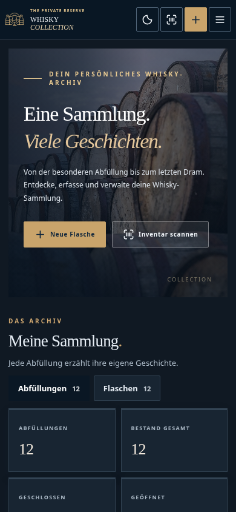

# Whisky Collection Manager v1.5.0

Lokale Webanwendung zur Verwaltung einer Whisky-Sammlung – von der Abfüllung über einzelne physische Flaschen bis zum Lagerfach. Eine Abfüllung kann mehrere Flaschen mit eigenen Inventarnummern, Zuständen, Fotos und Belegen enthalten.

Die Anwendung verwendet Node.js und Browser-ES-Module **ohne Datenbank und ohne Frontend-Build**. Sammlung und Lager werden in getrennten JSON-Dateien gespeichert. Sie läuft lokal oder auf einem Raspberry Pi als Docker-Container.

## Entwicklung und Code-Reviews

**Release-Strategie:** Aenderungen werden als Conventional Commits auf `develop` gesammelt; ein von dir freigegebener Merge nach `main` erzeugt automatisch genau einen getaggten Release-Snapshot mit der passenden Semantic-Version, dem Changelog, ZIPs und Docker-Images. Versionserhoehungen pro Entwicklungscommit entfallen. Fuer versionierte Quellcodeinstallationen das Git-Tag verwenden, nicht die unveraenderten Versionsdateien auf `main`. Details: [Release-Ablauf](docs/RELEASE_WORKFLOW.md).

### Commit-Nachrichten (Entwicklung)

Bei lokalen Aenderungen einmal pro Klon `npm run hooks:install` ausfuehren. Der lokale `commit-msg`-Hook verhindert ungueltige Conventional-Commit-Nachrichten bereits bei `git commit` (z. B. `fix(warehouse): Fach korrigieren`, `feat: neue Ansicht`). Neue Versionen werden weiterhin erst beim manuell gemergten PR `develop -> main` erstellt. Die GitHub-CI prueft Commit-Nachrichten zusaetzlich, weil lokale Git-Hooks umgangen werden koennen. [Release-Workflow](docs/RELEASE_WORKFLOW.md).


**GitHub Free (privat):** Rulesets und Branch-Protection werden nicht durchgesetzt. Der Release-Workflow veroeffentlicht deshalb nur nach einem nachweislich gemergten PR von `develop` nach `main`; unerlaubte Pushes auf `main` kann er nicht verhindern.


Die Anwendung wurde **vollständig durch ChatGPT programmiert**. Der Projektinitiator hat die Anforderungen formuliert und Korrekturen beziehungsweise Anpassungen angefordert, jedoch selbst keinen Anwendungscode geschrieben. Der Quellcode wird **regelmäßig mit Claude Code-Reviews unterzogen**.

Die technische Architektur verwendet einen gemeinsamen DOM-Abgleich und zentrale Ereignisbehandlung. Schreibvorgaenge aktualisieren den lokalen Zustand ueber revisionsgepruefte API-Aenderungen; bei konkurrierenden Aenderungen werden die betroffenen Daten neu geladen. Quellcode-ZIP-Upgrades koennen mit einem SHA-256-Dateimanifest auf entfernte Altmodule geprueft werden, ohne die Sammlung, das Lager oder Medien anzutasten. Details: [Architektur](docs/ARCHITEKTUR.md), [API](docs/API.md) und [Release-Ablauf](docs/RELEASE_WORKFLOW.md).

## Funktionen

| Bereich | Umfang |
| --- | --- |
| **Sammlung** | Abfüllungen und physische Flaschen verwalten; 0–n eigenständige datierte Verkostungen je Abfüllung sowie unabhängige Einzelverkostungen für nicht besessene Whiskys; Geschmacksprofil, Notizen, Farbe und Fünf-Gläser-Bewertung, mit Anzeige der letzten Bewertung in den Abfüllungsdetails und als dezente Glencairn-Gläser ohne Hintergrund auf dem Flaschenbild; Suche, Filter, Sortierung, Kachel- und Tabellenansicht sowie Scanner. |
| **Flaschen & Medien** | Inventarnummern, Zustände, Kaufdaten, Fotos, Belege und Anhänge; Verkostungsnotizen lassen sich über eine gemeinsame Hauptseite erfassen – für Sammlungsabfüllungen mit 0–n Verkostungen oder unabhängig als einzelne Verkostung mit eingebetteten Angaben zum Whisky. **Tasting-Flights** gruppieren optional mehrere Verkostungsnotizen mit gemeinsamem Kommentar. Die Verkostungsreihenfolge lässt sich per Ziehgriff mit Maus oder Touch ändern; Auf-/Ab-Buttons bleiben alternativ nutzbar. Die Glencairn- und Punktebewertungen sind in festen Spalten ausgerichtet. Jede Notiz kann höchstens einem Flight zugeordnet sein. Das Geschmacksprofil kann vollständig zurückgesetzt werden. Nicht-destruktiver Fotoeditor mit optionaler lokaler KI-Freistellung. Fehlende Bilder werden durch ein einheitliches Flaschenmotiv ersetzt. |
| **Analyse** | Bestands-, Wert- und Sammlungsanalysen mit Filtern und Zeitaggregationen. |
| **Landkarte** | OpenStreetMap-Destilleriekarte mit Standorten, Clustern und Statusfiltern. |
| **Lager** | Räume, Möbel und Fächer; 2D- und 3D-Raumplan, virtuelle Regalwand, Fachnavigation mit Schutz ungespeicherter Änderungen, sofort aktualisierte Kapazitäten, mehrere Fotos je Möbelstück sowie Einzel- und Mehrfach-Umlagerung. Import und Export von Raumplänen einschließlich optionaler Flaschenzuordnungen; bei belegten Räumen sichere Löschung mit vorheriger Freigabe aller Flaschen. |
| **Datensicherung** | Verschlüsselte AES-256-ZIP-Backups, manuell oder zeitgesteuert, für USB-, NAS- und Cloud-Ziele; Wiederherstellung nach Bestätigung. |
| **Oberfläche** | Responsive Light-/Darkmode-Oberfläche auf Deutsch und Englisch. |
| **Hilfe** | Eigene Hilfeseite mit aktuellen Bedienhinweisen zu Abfüllungen, Verkostungsnotizen (inklusive externer Abfüllungen, Lesemodus und Bewertung), Tasting-Flights (Zuordnung, Reihenfolge und Löschen), Lager und weiteren Funktionen sowie ausklappbaren technischen Backup-Anleitungen. |

Verkostungsunterseiten zeigen die Zurück-Navigation oberhalb des Seitentitels. Abfüllungsdaten stehen im ersten Inhaltsblock ohne zusätzliche Überschrift; das vorhandene Abfüllungsfoto aus der Abfüllungsdetailseite wird darin kompakt neben den Stammdaten angezeigt. Die Verkostungslisten verwenden die Zeilenstruktur von Lager → Flasche finden. Externe Abfüllungsdaten werden nur bei der erstmaligen Erfassung direkt eingegeben; danach erscheinen sie lesend mit einem Stift-Button zum Bearbeiten. Die drei Notizfelder bleiben oben ausgerichtet und einzeln in der Höhe veränderbar. Gespeicherte Verkostungen öffnen im Lesemodus; ein Stift-Button im ersten Datenblock (Datum und Titel) aktiviert die Bearbeitung. Der Info-Block einer Sammlungsabfüllung bietet einen direkten Link „Zu den Abfüllungsdetails“.

Auf der Abfüllungsdetailseite erhält jede physische Flasche **eine einzelne Karte ohne verschachtelten Rahmen**. Bei vorhandenen Fotos steht das **erste Bild der gespeicherten Reihenfolge links als kleinere Vorschau**, daneben stehen die **Flaschendaten in drei Spalten** mit Beschriftung über dem Wert und **ohne Trennlinien zwischen den Angaben** (an schmalen Viewports zweispaltig). **Fotos und Dateien/Nachweise beginnen jeweils links über die ganze Kartenbreite unter dem Kopfbereich.** Die Fotoleiste behält WB-/Freistellungsmarkierungen, Bildeditor, Löschen, Sortiergriff, Pfeile, Upload und Kameraaufnahme. Auf Mobilgeräten folgen auf die Vorschau erst die Flaschendaten, dann Fotos und Nachweise. Ohne Foto entfällt die Bildspalte; die Fotoaktionen bleiben verfügbar. Nach einer Umordnung wechselt das große Vorschaubild automatisch.

Der Upload von Belegen, Dokumenten und Fotos an physischen Flaschen aktualisiert die Detailansicht nach erfolgreicher Speicherung. **Foto- und Dateiaenderungen aktualisieren die Seite ohne sichtbares Hoch- und Zurueckscrollen; bestaetigte Dialogaktionen behalten die aktuelle Scrollposition bei.**

Anlegeaktionen verwenden dasselbe Plus-Symbol. In den Abfüllungsdetails steht „Neue Verkostung“ wie „Weitere Flasche“ über der jeweiligen Kachel; in Verkostungslisten befindet sich die Aktion innerhalb des Listenblocks. Im Verkostungseditor stehen Datum (schmal), Titel (breit) und Bearbeitungsaktionen in einer dreispaltigen Zeile, bei schmalen Ansichten umbrechend.

Die Bedienhinweise sind in der Anwendung über **Menü → Hilfe** (`/?view=help`) abrufbar. Lange Anleitungen werden nicht mehr dauerhaft in Arbeitsansichten und Formularen angezeigt; sicherheitsrelevante Warnungen bleiben vor den jeweiligen Aktionen sichtbar.

Ausführliche Funktions- und Bedienhinweise: [Geschmacksprofil](docs/GESCHMACKSPROFIL.md), [Lagerverwaltung](docs/LAGER.md), [Fotoeditor und Freistellung](docs/PHOTO_FREISTELLUNG.md), [Analysen](docs/ANALYSE.md), [Landkarte](docs/KARTE.md) und [Anforderungen](docs/ANFORDERUNGEN.md). Änderungen einzelner Versionen stehen ausschließlich im [Changelog](CHANGELOG.md).

## Einblicke in die Oberfläche

Die Screenshots zeigen Beispielansichten mit einer leeren Demo-Sammlung, keine privaten Daten.

| Desktop – hell | Desktop – dunkel |
| --- | --- |
|  |  |

<details>
<summary>Mobile Ansicht anzeigen</summary>



</details>

**2D-Raumplan mit Beispielmöbeln:**


## Lokal starten

**Voraussetzung:** Node.js 20 oder neuer. Im Repository-Verzeichnis:

```bash
npm start
```

Der Starthelfer installiert bei Bedarf npm-Abhängigkeiten, bereitet die lokalen KI-Dateien für die Freistellung vor, legt eine fehlende `.env` aus `.env.example` an und richtet bei Bedarf HTTPS-Zertifikate ein. Beim Start aus dem **normalen Quellcode-ZIP** ist dafür zunächst Internetzugang erforderlich. Das gesonderte Offline-Release-ZIP bringt die Pakete und KI-Dateien bereits mit. Für HTTPS wird `mkcert` oder OpenSSL benötigt. Vorhandene Konfigurationen werden nicht überschrieben.

Die Anwendung verwendet standardmäßig **HTTPS auf Port 3543**. Für ein Zertifikat mit einer bestimmten LAN-IP:

```bash
npm run https:setup -- --ip 192.168.178.50
npm start
```

Die Beispiel-IP durch die eigene Adresse ersetzen. Automatischen Server-Neustart beim Entwickeln bietet `npm run dev` (nach dem ersten `npm start`). Weiterführende Hinweise: [Entwicklung](docs/ENTWICKLUNG.md).

## Quellcode-ZIP ohne Datenverlust aktualisieren

Beim Ueberschreiben von ZIP-Versionen koennen entfernte JavaScript-Module auf der Platte bleiben. Fuer einen sicheren Abgleich den bisherigen und den neuen Release jeweils in **eigene Verzeichnisse** entpacken. Mit `node scripts/upgrade-audit.js <alt> <neu> <installation>` werden verwaiste Dateien nur angezeigt. Die ausdrueckliche Option `--prune` entfernt ausschliesslich unveraenderte alte Quellmodule, nicht aber Daten, Fotos, Belege, Einstellungen oder lokal modifizierte Dateien. **Vor jedem Upgrade ein vollstaendiges Backup** von Sammlung, Lager und Medien erstellen. Details und Beispiele: [Release-Workflow](docs/RELEASE_WORKFLOW.md).

Docker-Updates bleiben unveraendert und benoetigen diesen ZIP-Abgleich nicht.

## Langfristige Offline-Wiederherstellung

GitHub Releases enthalten ab v0.20.0 neben dem Quellcode ein **Offline-Installations-ZIP mit npm-Paketcache und KI-Dateien** sowie archivierte Docker-Images fuer **ARM64 (Raspberry Pi)** und **AMD64**. Jedes Archiv hat eine SHA-256-Pruefsumme. Eine Neuinstallation aus den archivierten Artefakten ist ohne Paketserver, Modellhosting oder Container-Registry moeglich, sofern Node.js beziehungsweise Docker bereits auf dem Zielgeraet vorhanden sind. Die Datenbackups bleiben davon getrennt.

Die Offline-Artefakte lassen sich mit einem mitgelieferten Skript verifiziert auf denselben USB-/NAS-Datentraegern ablegen wie die bestehenden Backups. Vollstaendige Anleitung und Grenzen: [Offline-Releases](docs/OFFLINE_RELEASES.md).

## Raspberry Pi / Docker

**Voraussetzungen:** Raspberry Pi OS 64 Bit, Docker Engine mit Compose-Plugin, Git und OpenSSL. Für private GitHub-Repositories und Containerpakete muss der Zugriff eingerichtet sein.

```bash
git clone --branch main git@github.com:henryk86/whisky-collection-manager.git
cd whisky-collection-manager
cp deploy/.env.example .env
nano .env
sh deploy/setup-pi.sh
docker compose pull
docker compose up -d --remove-orphans
docker compose ps
```

Die App ist anschließend unter `https://<IP-des-Pi>:3543` erreichbar, sofern IP oder Hostname in der Zertifikatskonfiguration hinterlegt sind. Die Einrichtung verwendet einen Docker-Service `app` für Anwendung und Backup-Worker. Alle Sammlungs- und Lagerdaten sowie Fotos, Dokumente und Backups liegen **außerhalb des Repositorys** im über `WCM_DATA_DIR` konfigurierten Verzeichnis (standardmäßig `$HOME/whisky-collection-manager-data`). Container-Updates ersetzen diese Daten nicht.

**Sicherheit:** Es gibt **keinen allgemeinen Benutzerlogin**. Die App daher nur in einem vertrauenswürdigen Netz oder hinter zusätzlicher Zugriffskontrolle/VPN betreiben, nicht ungeschützt ins Internet freigeben. HTTPS allein ist keine Anmeldung. Für vollständige Sicherungen müssen Sammlung **und** Lager sowie Bilder und Dokumente enthalten sein.

### Updates

Vor dem Update ein geprüftes Backup erstellen. Bei der üblichen Git-/Docker-Installation:

```bash
git switch main
git pull --ff-only
docker compose pull
docker compose up -d --remove-orphans
```

Für reproduzierbare Deployments `IMAGE_TAG=vX.Y.Z` statt `latest` in `.env` setzen. Keine persistenten Datenverzeichnisse oder Docker-Volumes löschen; Quellcode-ZIPs sind kein Daten-Backup.

[Docker-Einrichtung, HTTPS, Host-Allowlist, Backupziele und Wiederherstellung](docs/DOCKER_BACKUP.md)

## Entwicklung und Tests

```bash
npm run check           # Syntax, Modulimporte, Sprachdateien und Dokumentationslinks
npm test                # Unit- und Integrationstests
npm run test:browser    # Browser-Tests (Playwright/Chromium erforderlich)
npm run release:check   # Versionskonsistenz
```

Die [Teststrategie](docs/TESTSTRATEGIE.md) beschreibt die Verhaltensabdeckung und die Trennung von Runtime- und Deployment-Vertragspruefungen. Der aktuelle Stand der tatsächlich durchgeführten Tests und offene Prüfungen sind in [TESTSTATUS](docs/TESTSTATUS.md) dokumentiert. Testhistorie: [TESTHISTORIE](docs/TESTHISTORIE.md). Browser- und Geräteprüfungen sind nicht durch die Node-Tests ersetzt.

Die Oberfläche ist auf Deutsch und Englisch lokalisiert. Die Sprachdateien liegen in [`public/locales`](public/locales/index.json); fachliche Konventionen und API-Verträge erläutern [Entwicklung](docs/ENTWICKLUNG.md) und [API](docs/API.md).

## Versionierung und Release

Entwicklung erfolgt auf `develop`: direkte Commits und optional PRs. Jeder Commit verwendet ein Conventional-Commit-Praefix, z. B. `fix:`, `feat:`, `refactor:` oder `docs:`. Einzelne Commits erhoehen **keine** Versionsnummer. Ausschliesslich ein durch dich gemergter PR `develop -> main` startet nach den CI-Pruefungen einen versionierten GitHub Release mit Quellcode-ZIP und Docker-Image fuer AMD64/ARM64. Der hoechste Commit-Typ entscheidet einmalig ueber Patch, Minor oder Major.

```bash
npm run check           # Entwicklungspruefungen
npm test                # Verhaltens- und Integrationstests
npm run release:check   # Fertigen Release-Snapshot pruefen, kein Entwicklungs-Bump
```

`npm run release:bump` ist nur noch ein historisches Werkzeug und darf im normalen Entwicklungsablauf nicht ausgefuehrt werden.

[Release-Workflow](docs/RELEASE_WORKFLOW.md) · [Changelog](CHANGELOG.md)

## Dokumentation

| Dokument | Inhalt |
| --- | --- |
| [ARCHITEKTUR](docs/ARCHITEKTUR.md) | Module, Datenflüsse und Datenablage |
| [ANFORDERUNGEN](docs/ANFORDERUNGEN.md) | Fachliche Regeln und Funktionsumfang |
| [API](docs/API.md) | HTTP-Endpunkte und Datenformate |
| [LAGER](docs/LAGER.md) | Räume, Möbel, Fächer und Umlagerung |
| [PHOTO_FREISTELLUNG](docs/PHOTO_FREISTELLUNG.md) | Bildbearbeitung und KI-Freistellung |
| [ANALYSE](docs/ANALYSE.md) | Auswertungen und Zeitfilter |
| [KARTE](docs/KARTE.md) | Destilleriestandorte und Karte |
| [DOCKER_BACKUP](docs/DOCKER_BACKUP.md) | Docker, Sicherheit und Datensicherung |
| [ENTWICKLUNG](docs/ENTWICKLUNG.md) | Entwicklungsrichtlinien und Tests |
| [RELEASE_WORKFLOW](docs/RELEASE_WORKFLOW.md) | CI/CD und Versionierung |
| [TESTSTATUS](docs/TESTSTATUS.md) | Aktueller Prüfstand |
| [TECHNISCHE_SCHULDEN](docs/TECHNISCHE_SCHULDEN.md) | Bekannte offene Punkte |

Lizenz: [MIT](LICENSE). Mitgelieferte Fremdbibliotheken und Medien können eigenen Lizenzbedingungen unterliegen.
